# Báo cáo benchmark CrossGOverlay — Release x64

**Ngày đo:** 2026-10-25–29 (Asia/Saigon) · **Phiên bản:** 1.0.0 · **Runtime:** .NET 8.0.31, WPF · **Máy đo:** Windows 10.0.26200, 16 bộ xử lý logic. Hash của apphost `CrossGOverlay.exe` bắt đầu bằng `7DA83E403D86A05D`; hash của DLL managed và phiên đo nằm trong [manifest build](benchmarks/results/profiling-build-20261026.json) cùng metadata từng lượt.

> **Phạm vi kết quả:** Báo cáo **chưa hoàn tất toàn bộ checklist**. Dữ liệu gốc ngày 25/10 ở phần đầu; [đợt profiling chuyên sâu ngày 26/10](#đợt-profiling-chuyên-sâu-2026-10-26--release-x64-ngoài-game) bổ sung VMMap 5 snapshot, 100 chu kỳ Settings, idle 60 phút, GIF fixture 60 phút, startup phân pha, cuộn nền ảnh 60/144, GPU process memory, hiệu ứng ngắn và 500–1000 lần đổi preset. [Đợt điều tra 27/10](#điều-tra-tiếp-ngày-2026-10-27--startup-private-data-gdi-và-gpu-cùng-tiến-trình) thêm startup trước/sau, GDIView và A/B toast/GPU cùng PID. [Đợt ETW elevated ngày 29/10](#etw-elevated-ngày-2026-10-29--toast-gdi-và-ui-present) đã có allocation stack Toast, stack tạo GDI Region và nhịp `Present`; **vẫn chưa có** P95/P99 thời gian xử lý frame WPF, startup cold hay dữ liệu game. Không suy diễn FPS game từ CPU/RAM tiến trình.

## Phương pháp và dữ liệu gốc

- Build: `dotnet build Crosshair.sln -c Release -p:Platform=x64 --no-restore` — 0 warning, 0 error. Chạy file ở `src/CrosshairOverlay/bin/x64/Release/net8.0-windows/win-x64/CrossGOverlay.exe`, không gắn debugger.
- Script [Measure-CrossGOverlay.ps1](benchmarks/Measure-CrossGOverlay.ps1) lấy mẫu `Process.TotalProcessorTime`, Working Set, Private Bytes, tổng handle và `GetGuiResources` (GDI/USER). CPU được chuẩn hóa theo **16 bộ xử lý logic**; mỗi mẫu cách nhau khoảng 1 giây. Giá trị 0 trong các mẫu chỉ là **0 ở độ phân giải phép đo này**, không chứng minh 0 chu kỳ CPU hoặc 0 lần đánh thức.
- Mốc startup là thông điệp `SettingsWindow.OnContentRendered` tự ghi trong log. Mốc HWND đầu tiên có thể thuộc Splash, nên **không** được dùng làm thời gian mở Settings. “Cold start” thật cần kiểm soát cache OS/reboot; lượt đầu với dữ liệu mới không được gọi là cold start.
- Script chỉ khởi chạy và kết thúc PID do chính nó tạo. Biến môi trường `CROSSGOVERLAY_BENCHMARK_ROOT` trỏ dữ liệu của tiến trình benchmark vào `benchmarks/results/app-data` để không đụng settings/preset thật; script không gắn debugger. Dữ liệu app tạm được bỏ qua bởi `.gitignore`.
- Dữ liệu gốc: [10 lần startup](benchmarks/results/20261025T161013Z-Startup-runs.json), [1.800 mẫu idle](benchmarks/results/20261025T161042Z-IdleHidden-samples.csv), [tổng hợp JSON](benchmarks/results/summary.json), [CSV từng lượt/trung vị/độ lệch chuẩn](benchmarks/results/summary.csv), [4 lần System.Runtime](benchmarks/results/managed-gc-20261025T164851Z.csv) và [mẫu GPU Process Memory](benchmarks/results/managed-gc-20261025T164851Z-gpu-memory.csv). Ba file GC/GPU còn lại cùng mẫu tên trong `benchmarks/results/`; mọi giá trị trong bảng dưới đây tính từ các CSV gốc. Cột baseline/chênh lệch của CSV app-only để trống vì không có bản trước tối ưu được đo cùng giao thức. Script kiểm tra log **khởi động hoàn tất**, hủy lượt đo khi có lỗi startup. Các lượt thử đầu trong sandbox bị loại vì `H.NotifyIcon` không tạo được tray icon; chúng không nằm trong thống kê.
- System.Runtime được thu bằng `dotnet-counters` bản 10.0.731102, nhịp 2 giây, 22 mẫu/counter/lượt; GPU Process Memory bằng Windows Performance Counter, 15 mẫu/lượt. [CSV tổng hợp runtime](benchmarks/results/runtime-summary.csv) lưu từng lượt, trung vị và độ lệch chuẩn mẫu; baseline/chênh lệch để trống vì không có phép đo tương ứng trước tối ưu. Các phép đo này có profiler/counter gắn kèm nên **không gộp** với 3 lượt CPU/RAM idle không profiler. GPU `Shared Usage` là bộ nhớ đồ họa chia sẻ của **toàn tiến trình**, không phải VRAM riêng của overlay. Không có số liệu DWM compositing.
- Baseline **trước đợt tối ưu** chưa được thu trên cùng máy, cùng dữ liệu và cùng phương pháp. Bảng “Baseline / hiện tại” bên dưới để trống baseline một cách có chủ đích; không tính phần trăm cải thiện giả.

### Ma trận 8 kịch bản của phiên gốc 2026-10-25

Trạng thái ở bảng này chốt tại ngày 25/10; các kịch bản thực hiện thêm ngày 26/10 được ghi ở phần profiling chuyên sâu cuối báo cáo.

| # | Kịch bản yêu cầu | Đã thực hiện | Kết luận |
|---|---|---|---|
| 1 | Idle, Settings ẩn, 10 phút × 3 | 600 giây × 3, sau khi startup hoàn tất và toast đóng | Đạt thời lượng; CPU đạt ngưỡng theo độ phân giải lấy mẫu, Private Bytes vượt ngưỡng |
| 2 | Delta Force Firing Range: không app / overlay tĩnh / overlay GIF, mỗi trạng thái 5 × 120 giây | Chưa chạy game/PresentMon | Chưa đo; chờ phương pháp capture được phép |
| 3 | Chi phí Overlay GIF/RGB riêng, 10 phút × 3 | Chưa kích hoạt hiệu ứng trong phiên đo | Chưa đo |
| 4 | Cuộn Settings có ảnh nền, 2–3 phút × 3 | Chưa tạo thao tác cuộn/ảnh nền và chưa có frame trace | Chưa đo |
| 5 | Đổi 500 preset × 3 | Chưa có bộ điều khiển UI tự động và trace latency | Chưa đo |
| 6 | Mở/ẩn Settings 100 chu kỳ × 3 | Chưa tự động hóa chu kỳ mở lại từ tray | Chưa đo |
| 7 | Phiên game 60 phút × 3 | Chưa chạy game | Chưa đo |
| 8 | 10 warm + 5 cold startup | 10 lượt warm hợp lệ | Warm đã đo; cold chưa đo |

## 1. CPU và hoạt động nền

**Kết quả đo:** 1.800 mẫu trong ba phiên Settings ẩn 10 phút đều ghi `0.00000%` CPU chuẩn hóa theo 16 bộ xử lý logic (600 mẫu/lượt). Đây là mức **dưới độ phân giải của bộ lấy mẫu Process.TotalProcessorTime**. `dotnet-counters` khi gắn vào bốn phiên 45 giây đọc CPU trung bình 0,0200–0,0356%, nhưng công cụ đo có overhead và không đại diện cho idle 10 phút. Mã nguồn foreground dùng WinEventHook, còn timer dự phòng chỉ bật nếu hook lỗi; đó là nhận xét mã nguồn, không chứng minh wakeup bằng 0.

| Chỉ số | Baseline trước tối ưu | Hiện tại | Mục tiêu | Đánh giá |
|---|---:|---:|---:|---|
| Idle CPU, Settings ẩn | Chưa đo | 0.00000% ở 1.800 mẫu 1 giây | ≤0.1% TB | **PASS theo phép đo này** |
| CPU khi gắn EventPipe | Chưa đo | 0,0200–0,0356% TB trong 4 lượt 45 giây | Không đặt | Tham chiếu, có overhead |
| CPU peak dưới 1 giây | Chưa đo | Không phân giải được trong lượt idle 1 giây | Không đặt | Chưa đo |
| CPU wakeups/context switches | Chưa đo | Không có bộ đếm per-process đáng tin cậy | Gần 0 khi rảnh | Chưa đo |

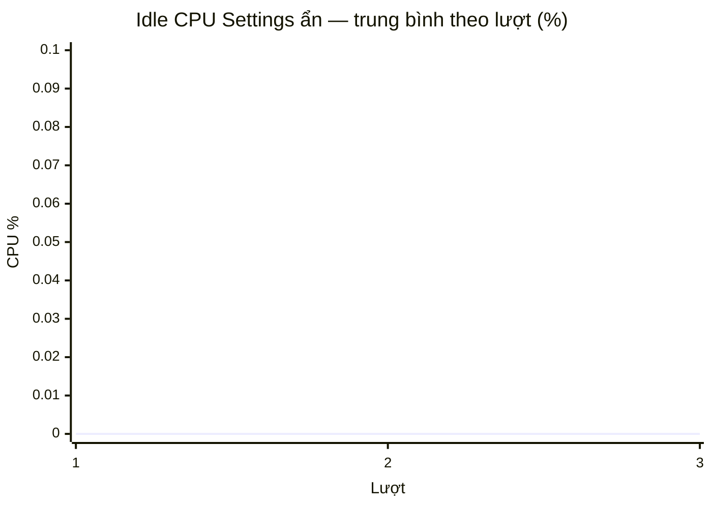

Biểu đồ là **số đọc được**, không phải chứng nhận CPU thực sự bằng 0. Cần ETW/WPR hoặc công cụ tương đương để kết luận wakeups, context switches và spike ngắn.

## 2. RAM và Garbage Collector

**Kết quả đo không gắn profiler:** Working Set trung bình gộp **296,791 MB**, Private Bytes **219,643 MB** trên 1.800 mẫu. Private Bytes lớn nhất **223,086 MB**, vượt ngưỡng đề xuất 120 MB. Kết quả có cấu hình benchmark cô lập, không có ảnh nền tùy chỉnh và không có game; chưa có baseline trước tối ưu để quy nguyên nhân.

| Lượt 10 phút | Private TB | Working Set TB | Private đầu → cuối | Working Set đầu → cuối |
|---:|---:|---:|---:|---:|
| 1 | 220,030 MB | 297,621 MB | 222,734 → 220,227 MB | 300,238 → 298,312 MB |
| 2 | 219,509 MB | 295,287 MB | 222,445 → 219,652 MB | 297,891 → 295,785 MB |
| 3 | 219,389 MB | 297,464 MB | 223,086 → 219,547 MB | 300,512 → 297,992 MB |

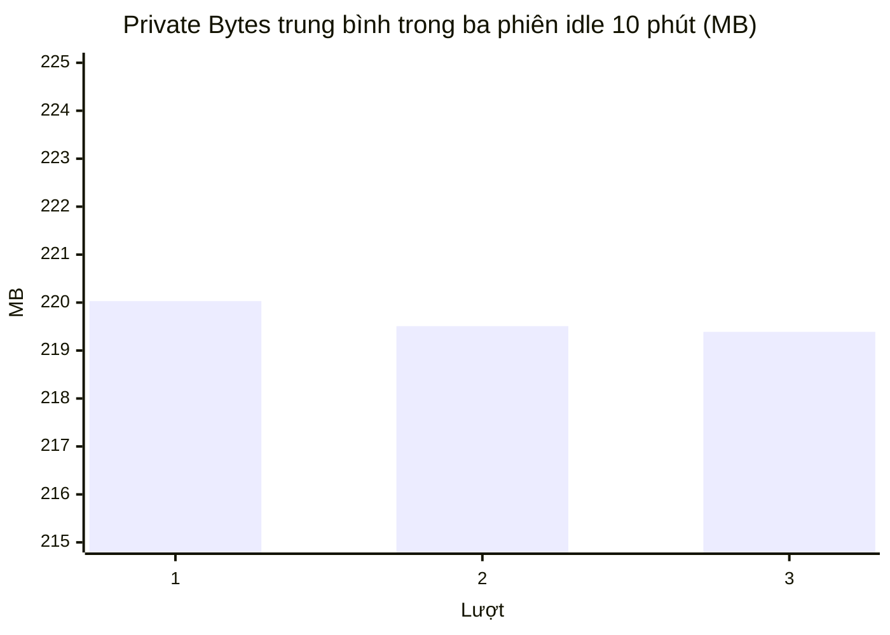

**System.Runtime trong bốn phiên riêng (45 giây/phiên):** GC Heap trung bình lần lượt **9,785 / 9,755 / 9,788 / 9,757 MB**; Allocation Rate trung bình **18.327 / 16.849 / 17.215 / 18.508 B mỗi 2 giây** (xấp xỉ 8–9 KB/s). Cả 88 mẫu ghi **0 ms thời gian GC pause trong cửa sổ 2 giây** và Gen 0/1/2 count đều bằng 0. Điều này chỉ xác nhận không quan sát được GC trong các cửa sổ ngắn đó; counter “% Time in GC since last GC” có giá trị cũ không được dùng để suy ra pause. Không có dữ liệu 60 phút hay lúc `SustainedLowLatency` hoạt động. `ArrayPool<byte>` của `ImageBlurHelper` không được kích hoạt, nên không thể kết luận hiệu quả từ bài idle.

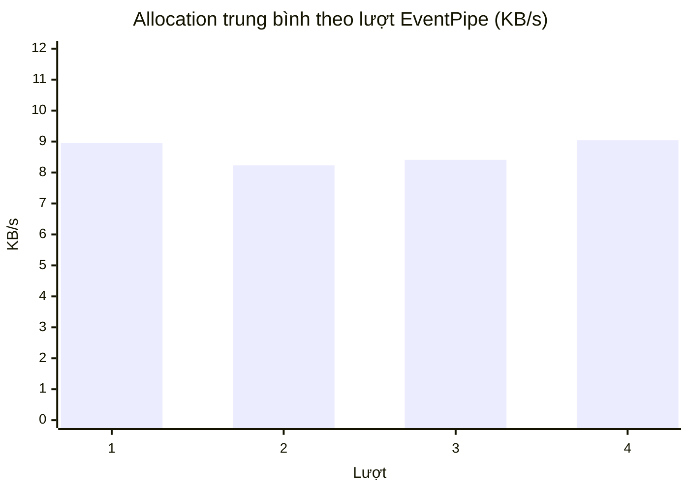

**Đánh giá:** Private Bytes ≤120 MB **FAIL**. Heap khoảng 9,8 MB trong 45 giây **chưa đủ** kết luận ổn định dài hạn; cần heap dump/ETW để giải thích phần native/WPF/private còn lại.

## 3. GPU, VRAM và Layered Window Compositing

Source review xác nhận Overlay dùng HWND layered/click-through và tính lại vị trí/kích thước theo vùng tâm thực tế khi thay đổi; `SetWindowPos` không gọi lại khi placement không đổi. Đây là nhận xét **mã nguồn**, không phải đo DWM. Ba lượt bộ đếm Windows `GPU Process Memory` khi Settings ẩn (không có game) ghi Shared Usage **156,5469 / 156,4766 / 156,5547 MB**; Dedicated Usage **0 MB** trong 15 mẫu mỗi lượt. Đây là số liệu **toàn tiến trình** do driver/counter cung cấp, có thể gồm WPF/ứng dụng; không được gọi là VRAM của overlay hoặc chi phí DWM.

| Chỉ số | Baseline | Hiện tại | Trạng thái |
|---|---:|---:|---|
| GPU shared memory của tiến trình | Chưa đo | 156,477–156,555 MB; 3 lượt × 15 mẫu | Đã đo ngoài game, phạm vi tiến trình |
| GPU dedicated memory counter | Chưa đo | 0 MB ở cả ba lượt | Counter không ghi allocation dedicated; không suy ra GPU không làm việc |
| DWM GPU busy / alpha composite | Chưa đo | Chưa đo | Chưa đo |
| Diện tích HWND khi game active | Chưa đo | Không có game trong phiên đo | Chưa đo |

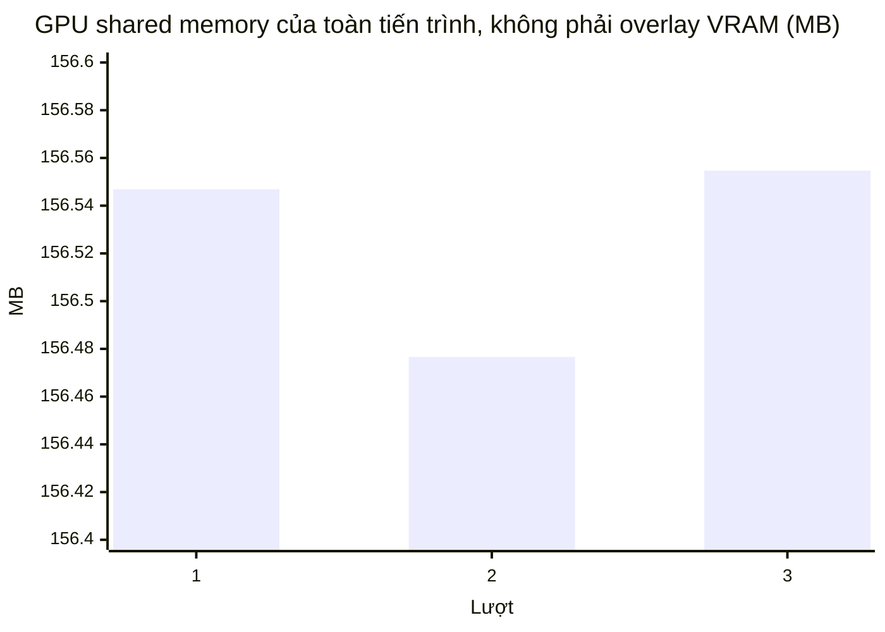

## 4. UI frame time khi cuộn Tab Chung có ảnh nền

Không chạy thao tác cuộn với ảnh nền và không có ETW/WPF frame event. Các lượt Settings ẩn và lấy mẫu EventPipe ở trên **chỉ là idle**, không thể suy ra P50/P95/P99 từ CPU trung bình. Mốc 144 Hz tương ứng `1000/144 = 6.944 ms` mỗi frame; kiểm tra acceptance sau này phải dùng frame time quan sát được, không dùng giới hạn FPS đặt trong cấu hình.

| Frame time | Baseline | Hiện tại | Ngưỡng | Trạng thái |
|---|---:|---:|---:|---|
| P50 | Chưa đo | Chưa đo | Tham chiếu 6.94 ms | Chưa đo |
| P95 | Chưa đo | Chưa đo | ≤6.94 ms | Chưa đo |
| P99 | Chưa đo | Chưa đo | ≤6.94 ms | Chưa đo |
| Layout Measure/Arrange mỗi giây | Chưa đo | Chưa đo | Giảm so baseline | Chưa đo |

```text
P50  | ?                            mốc 144 Hz | 6.94 ms
P95  | ?                            mốc 144 Hz | 6.94 ms
P99  | ?                            mốc 144 Hz | 6.94 ms
```

## 5. Tác động lên game

Người dùng đã chọn **Delta Force — Firing Range**, ba trạng thái `NoApp`, `OverlayStatic`, `OverlayGif`, mỗi trạng thái **5 lượt × 120 giây**. Delta Force hiện không chạy trên máy; không có lượt game nào được ghi. Tuyên bố “≤0.5% suy giảm 1% Low” **chưa được xác minh**. Cần cố định game, cảnh, thiết lập đồ họa, độ phân giải, driver và chạy xen kẽ baseline/app để giảm sai lệch nhiệt độ và cache.

Đã xác nhận bằng thao tác **chỉ đọc** rằng `C:\Program Files\NVIDIA Corporation\FrameViewSDK\bin\PresentMon_x64.exe` tồn tại, phiên bản `1.9.12728.0`, chữ ký **NVIDIA Corporation / Valid**, SHA-256 `E8625989D93A9B5353AE5627459EBC3FBFBB353D249411551EB10DDE5A1B3B03`. Đây là bản đi kèm FrameViewSDK, không mặc nhiên là bản phát hành Intel PresentMon. **Không khởi chạy** công cụ này cùng Delta Force. [Garena Delta Force Việt Nam](https://deltaforce.garena.vn/news/huong-dan-chung/danh-sach-phan-mem-phan-cung-bi-cam) xếp các ví dụ công cụ frame capture vào nhóm không khuyến nghị, nói danh sách có thể bổ sung và không xác nhận riêng PresentMon được phép. [Mã nguồn PresentMon](https://github.com/GameTechDev/PresentMon) mô tả mục đích phân tích frame, nhưng cơ chế kỹ thuật không thay thế xác nhận của nhà phát hành game. Đây là đánh giá thận trọng, không phải phán quyết về anti-cheat.

Đã chuẩn bị [mẫu CSV 15 lượt](benchmarks/delta-force/firing-range-template.csv) và [script tổng hợp](benchmarks/delta-force/Summarize-FiringRange.ps1). Script chỉ tạo CSV kết quả khi đủ 15 dòng `MEASURED`, mỗi dòng đúng 120 giây tại Firing Range và được đánh dấu `PolicyChecked=YES`; nó tính trung vị, độ lệch chuẩn mẫu và chênh lệch so với trung vị baseline. Mẫu hiện để trống mọi chỉ số; **không chứa số benchmark giả**. Mọi thao tác game cần người chơi thực hiện thủ công, không dùng script gửi phím hoặc can thiệp tiến trình Delta Force.

**Giao thức khi có phương pháp được phép:** giữ cố định màn hình/độ phân giải, thiết lập đồ họa, giới hạn FPS, lộ trình tại Firing Range và phiên bản driver. Thực hiện năm vòng, mỗi vòng ba trạng thái theo thứ tự luân phiên để giảm thiên lệch nhiệt độ/cache; mỗi lượt 120 giây và dùng cùng định nghĩa frame time. Nếu CSV từng frame được cấp phép, tính `Average FPS = 1000 / mean(frame time ms)`, `1% Low FPS = 1000 / mean(1% frame time chậm nhất)`, P95/P99 từ phân vị frame time; ghi rõ tiêu chí đếm spike trước khi so sánh. Thu CPU/RAM/GC/GPU của **CrossGOverlay**, không đọc bộ nhớ hay gắn profiler vào game. Không đặt `PolicyChecked=YES` khi chỉ mới tìm thấy executable PresentMon.

```text
Delta Force Firing Range — 5 × 120 giây mỗi trạng thái
NoApp           [ N/A: chưa có CSV frame time được phép ]
OverlayStatic   [ N/A ]
OverlayGif      [ N/A ]
Average FPS / 1% Low / P95 / P99 / spike: N/A
Δ so baseline:  N/A
```

## 6. Render invalidation và lượt vẽ thừa

`CrosshairVisualHost` chỉ chủ động `InvalidateVisual()` khi Drawing hoặc EdgeMode thay đổi. Bộ đếm `OnRender`/invalidations/`SetWindowPos` được biên dịch dưới `#if DEBUG`, nên **không có** trong bản Release x64 đã đo. Unit test Debug của đường vẽ tĩnh đã kiểm tra gán lại cùng Drawing không yêu cầu redraw; điều đó **không thay thế** phép đo `OnRender calls/s` runtime khi game đứng yên.

| Chỉ số | Baseline | Release x64 | Mục tiêu |
|---|---:|---:|---:|
| `InvalidateVisual` chủ động khi tĩnh | Chưa đo | Không có counter trong Release | 0/s |
| `OnRender` khi tĩnh | Chưa đo | Không có counter trong Release | 0/s ngoài redraw hệ thống |
| `SetWindowPos` khi tĩnh | Chưa đo | Không có counter trong Release | Chỉ khi placement/z-order đổi |

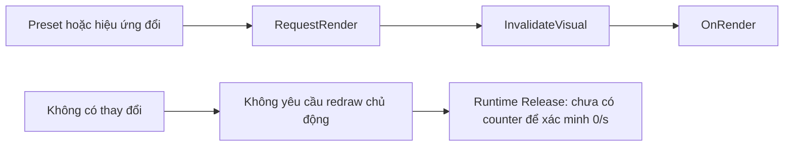

## 7. Độ ổn định dài hạn, GDI/USER handles và chu kỳ mở/ẩn

Trong ba phiên **600 giây** Settings ẩn, GDI giữ **50→50**; USER dao động **39→40**, **39→37**, **41→40**. Tổng handle giảm trong từng lượt. Private Bytes cuối phiên thấp hơn đầu phiên ở cả ba lượt. Không quan sát thấy tích lũy trong phép đo idle 10 phút; điều này **không thay thế** bài 60 phút có game hoặc 100–500 chu kỳ mở/ẩn/đổi preset.

| Lượt | GDI đầu → cuối | USER đầu → cuối | Tổng handle đầu → cuối | Private Bytes đầu → cuối |
|---:|---:|---:|---:|---:|
| 1 | 50 → 50 | 39 → 40 | 711 → 702 | 222,734 → 220,227 MB |
| 2 | 50 → 50 | 39 → 37 | 690 → 684 | 222,445 → 219,652 MB |
| 3 | 50 → 50 | 41 → 40 | 720 → 702 | 223,086 → 219,547 MB |

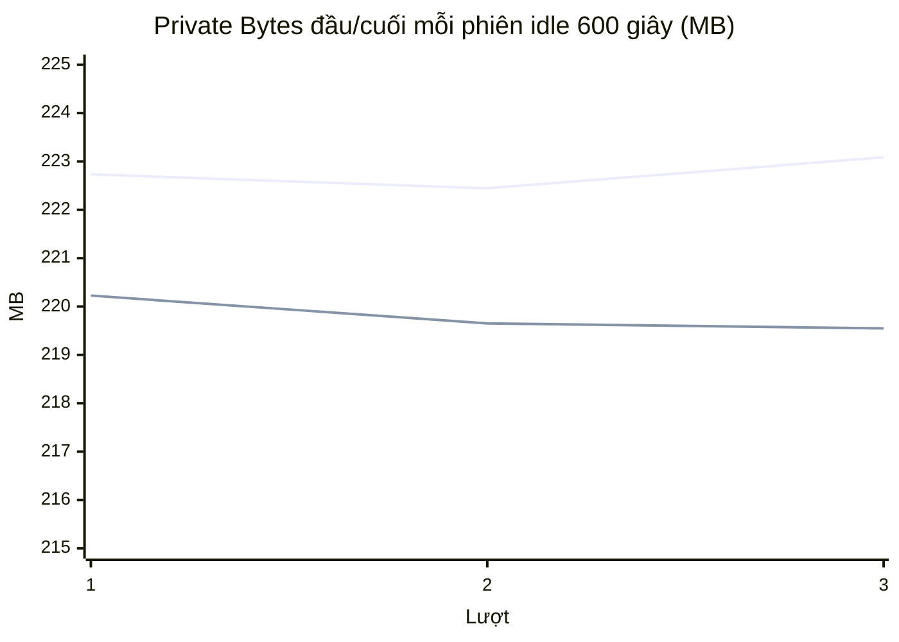

Chưa có phép đo retention GPU sau mở/ẩn và chưa chạy giao thức dài hạn; trạng thái acceptance dài hạn là **chưa đo**.

## 8. Startup và ma trận 12 nhóm chỉ số

10 lượt “warm” hợp lệ liên tiếp, mỗi lần khởi chạy tiến trình mới cùng dữ liệu benchmark: thời gian `SettingsWindow.OnContentRendered` **961–1241 ms**, trung bình **1050.3 ms**, trung vị **1043.5 ms**, P95 mẫu **1241 ms**. Mục tiêu warm `<50 ms` **không đạt** theo mốc khung hình đầu tiên. Mốc `<700 ms` cold chưa kiểm tra đúng giao thức.

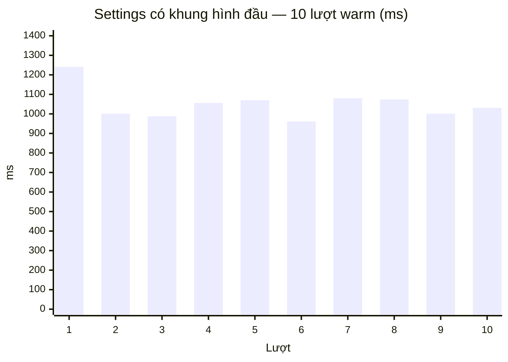

| # | Nhóm chỉ số | Baseline | Sau tối ưu / bản hiện tại | Tiêu chí | Trạng thái |
|---:|---|---|---|---|---|
| 1 | Idle CPU | Chưa đo | 0% theo độ phân giải mẫu, 3 × 600 giây | ≤0,1% TB | **PASS trong giao thức idle** |
| 2 | CPU peak, wakeups, context switches | Chưa đo | Peak 1 giây 0%; wakeups/context chưa đo | Không có peak bất thường | **Chưa đo đủ** |
| 3 | Working Set | Chưa đo | 296,791 MB TB khi ẩn | Ổn định dài hạn | **Ổn định 10 phút; dài hạn chưa đo** |
| 4 | Private Bytes | Chưa đo | 219,643 MB TB, max 223,086 MB | ≤120 MB | **FAIL** |
| 5 | Managed Heap, Allocation Rate | Chưa đo | Heap 9,755–9,788 MB TB; 8–9 KB/s trong 4 lượt 45 giây | Không tăng đều | **Quan sát ngắn; dài hạn chưa đo** |
| 6 | GC pause, low-latency mode | Chưa đo | 0 ms pause ở 88 mẫu idle; game mode chưa đo | Không tăng spike; guard 250 MB | **Quan sát ngắn; game chưa đo** |
| 7 | GPU, VRAM, DWM | Chưa đo | Shared GPU memory 156,477–156,555 MB; DWM chưa đo | Không tăng tích lũy | **Phạm vi tiến trình; DWM chưa đo** |
| 8 | UI P50/P95/P99, layout | Chưa đo | Chưa cuộn nền ảnh/trace | P95/P99 ≤6.94 ms | **Chưa đo** |
| 9 | Game Average/1% Low FPS | Chưa đo | Chưa có game/PresentMon | 1% Low giảm ≤0.5% | **Chưa đo** |
| 10 | `OnRender`/Invalidate | Chưa đo | Counter chỉ có ở Debug | 0 redraw chủ động/s khi tĩnh | **Chưa đo trên Release** |
| 11 | GDI/USER/handle lifetime | Chưa đo | GDI 50→50 trong 3 × 600 giây | 100–500 chu kỳ, 60 phút | **Ổn định 10 phút; chu kỳ chưa đo** |
| 12 | Latency tác vụ: startup/preset | Chưa đo | Warm first frame TB 1050.3 ms; 500 preset chưa đo | Warm <50 ms; cache ổn định | **FAIL startup; preset chưa đo** |

### Cách tái chạy và hoàn tất checklist

```powershell
dotnet build .\Crosshair.sln -c Release -p:Platform=x64 --no-restore
dotnet tool install dotnet-counters --tool-path .\benchmarks\tools --version 10.0.731102
powershell -NoProfile -ExecutionPolicy Bypass -File .\benchmarks\Measure-CrossGOverlay.ps1 -Scenario Startup -Runs 10
powershell -NoProfile -ExecutionPolicy Bypass -File .\benchmarks\Measure-CrossGOverlay.ps1 -Scenario IdleHidden -Runs 3 -DurationSeconds 600
powershell -NoProfile -ExecutionPolicy Bypass -File .\benchmarks\Summarize-CrossGOverlay.ps1 -StartupRunsJson .\benchmarks\results\20261025T161013Z-Startup-runs.json -SamplesCsv .\benchmarks\results\20261025T161042Z-IdleHidden-samples.csv -OutputJson .\benchmarks\results\summary.json
powershell -NoProfile -ExecutionPolicy Bypass -File .\benchmarks\Collect-ManagedGc.ps1 -DurationSeconds 45
powershell -NoProfile -ExecutionPolicy Bypass -File .\benchmarks\Summarize-ManagedGc.ps1
```

Với kịch bản GIF/RGB, cuộn nền ảnh, 500 preset và mở/ẩn 100 chu kỳ **ngoài game**: chạy app Release từ cùng binary, chuẩn bị thao tác tương ứng rồi lấy mẫu bằng `-Scenario Observe -ProcessId <PID> -Name <TenKichBan> -Runs 1 -DurationSeconds <thoiGian>`. Lặp ít nhất ba lượt độc lập, ghi thời điểm bắt đầu/kết thúc thao tác để ghép với trace; Observe không tự thao tác UI. Có thể dùng `dotnet-trace` cho CPU/GC và WPR/ETW cho layout/frame, nhưng phải tách overhead profiler khỏi lượt idle gốc. **Không chạy PresentMon hay công cụ bắt frame cùng Delta Force cho tới khi nhà phát hành xác nhận phương pháp/phiên bản cụ thể được phép.** Sau đó người chơi có thể ghi 15 CSV đo Firing Range; script tổng hợp chỉ chấp nhận dữ liệu đã đo hợp lệ.

**Ưu tiên sau báo cáo:** (1) profiler heap/ETW ngoài game để phân rã Private Bytes >120 MB; (2) đo khung hình UI có ảnh nền bằng ETW; (3) xác minh phương pháp capture được Delta Force cho phép trước khi chạy A/B trong game; (4) bài dài hạn 60 phút và 100 chu kỳ. Chỉ tối ưu tiếp khi có số đo của đường nóng cụ thể.

---

## Đợt profiling chuyên sâu 2026-10-26 — Release x64, ngoài game

Phần trên là **bản chốt dữ liệu ngày 2026-10-25**. Phần này bổ sung phép đo mới, không thay các hàng lịch sử bằng số suy đoán. Các script dùng thư mục cấu hình cô lập, không chạy Delta Force hay PresentMon, không ép `GC.Collect()` hoặc trim Working Set. VMMap 3.4 có chữ ký Microsoft hợp lệ; bản đồ vùng nhớ chi tiết được giữ cục bộ trong `benchmarks/results/vmmap/` và bị Git bỏ qua vì chứa đường dẫn máy. Các bảng tổng hợp ở dưới dùng **MiB** (`byte / 1.048.576`), dù tên cột CSV kế thừa hậu tố `MB`.

**Nhận diện binary:** `CrossGOverlay.exe` là apphost và giữ cùng SHA-256 `7DA83E...` qua hai lượt build; hash đó **không đủ** nhận diện thay đổi C#. [Manifest build sau](benchmarks/results/profiling-build-20261026.json) ghi SHA-256 managed `CrossGOverlay.dll` là `18EE546E...`. Phiên VMMap/idle 60 phút khởi chạy trước lần build thêm mốc click/T1 sau DI; hash DLL cũ chưa được lưu. Không dùng chênh tuyệt đối giữa phiên memory đó và phiên UI/effect sau build để tuyên bố cải thiện do code. Hai thay đổi C# sau là chẩn đoán có điều kiện, không đổi đường render khi biến benchmark không bật.

### Pha 1 và 5 — VMMap, 100 chu kỳ Settings, idle 60 phút

Một tiến trình Release x64 được khởi động vào tray với overlay hiện. UI Automation mở Settings, chọn toàn bộ **7 tab thực có trong mã** (Crosshair, General, Hotkeys, Games, Library, Create Crosshair/Pixel Art, Stats), ẩn 30 giây, thực hiện 100 lần mở/ẩn, rồi lấy 361 mẫu trong **3600,6 giây**. Danh sách trong yêu cầu gọi “Tạo Crosshair” và “Vẽ Pixel” riêng; ứng dụng hiện có một tab Create Crosshair chứa Pixel Art. Dữ liệu gốc: [VMMap theo trạng thái](benchmarks/results/memory-profile-20261026T040659Z-vmmap-summary.csv), [chuỗi mẫu lifetime](benchmarks/results/memory-profile-20261026T040659Z-lifetime.csv), [thống kê](benchmarks/results/memory-profile-20261026T040659Z-summary.csv), [metadata](benchmarks/results/memory-profile-20261026T040659Z-metadata.json).

| Trạng thái | Private tổng | Private Data | Managed Heap private | Heap native private | Image private | GDI | USER |
|---|---:|---:|---:|---:|---:|---:|---:|
| Overlay + tray, chưa mở Settings | 191,312 | 135,414 | 6,637 | 25,742 | 22,469 | 33 | 25 |
| Đã mở cả 7 tab | 239,371 | 148,809 | 22,457 | 44,168 | 22,781 | 47 | 46 |
| Ẩn Settings 30 giây | 228,707 | 149,992 | 22,457 | 32,457 | 22,781 | 49 | 43 |
| Sau 100 chu kỳ Show/Hide | 233,492 | 148,441 | 29,391 | 31,836 | 22,781 | 47 | 44 |
| Kết thúc thêm 60 phút idle | 233,969 | 148,371 | 29,391 | 32,688 | 22,781 | 47 | 41 |

Hai vùng `Private Data` riêng, **mỗi vùng 61,039 MiB**, có cùng địa chỉ và kích thước trong cả năm snapshot, chiếm 122,078 MiB ngay từ trạng thái overlay đầu tiên. VMMap chưa có stack cấp phát cho hai vùng này; **không thể quy chắc** chúng cho CLR, WPF Visual Tree hay GPU driver. Loại `Image` là private pages của image/DLL được map, không phải toàn bộ dung lượng DLL; `Managed Heap private` là trang private trong vùng GC, không đồng nghĩa với GC heap live khoảng 9,8 MiB đã đọc bằng `System.Runtime` ở phiên khác. Không cộng/trừ hai counter khác định nghĩa để gán phần dư cho driver.

So với trạng thái ẩn 30 giây, VMMap Private sau 100 chu kỳ tăng **4,785 MiB**; thêm 60 phút chỉ tăng **0,477 MiB**. Trong 361 mẫu idle, Process Private từ **236,652 → 237,113 MiB**, khoảng **236,250–237,184 MiB**; GDI **47→47**, USER **44→41**. Không thấy xu hướng tăng đều trong giờ quan sát này. Phần giữ lại sau 100 chu kỳ là tín hiệu cache/retention cần theo dõi, chưa chứng minh leak không giới hạn. Không có bằng chứng profiler để thêm ép GC hay cắt Working Set.

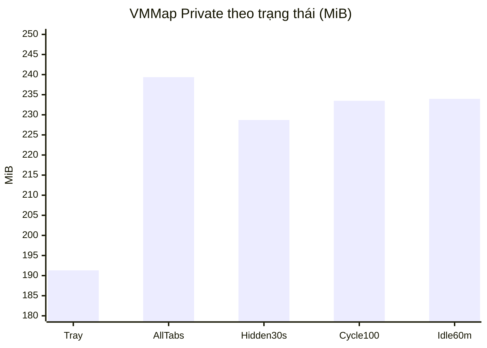

### Pha 2 — Phân rã startup và input đầu tiên

Chẩn đoán chỉ bật khi `CROSSGOVERLAY_BENCHMARK_TIMELINE=1`; mốc sau khi dựng `App` dùng `Stopwatch` độ phân giải cao, phần từ Process Start tới hàm dựng dựa trên `Process.StartTime`. Bài mở Settings thường chạy 10 lần: [CSV/JSON mốc từng lượt](benchmarks/results/20261026T074023Z-StagedStartupAfterDI-runs.json). Đường vào tray chạy 10 lần: [CSV từng lượt](benchmarks/results/20261026T074057Z-TrayStartup.csv). Click đầu tiên vào tab Chung chạy 10 lần khác: [CSV input](benchmarks/results/startup-input-20261026T074131Z-runs.csv). Lượt đầu mở Settings thường có `AppInitialized=1857,862 ms`, vượt xa chín lượt sau; bảng dùng trung vị và vẫn giữ lượt đó trong dữ liệu gốc.

| Mốc từ Process Start | Mở Settings thường: trung vị 10 lượt | Mở thẳng vào tray: trung vị 10 lượt | Ý nghĩa |
|---|---:|---:|---|
| T1 — App Initialized sau DI | 202,124 ms | 176,988 ms | Runtime, XAML cơ bản, logging và DI |
| Settings Initialized | 778,552 ms | Không khởi tạo cửa sổ | ViewModel/cửa sổ đã dựng |
| T4 — Settings first `OnContentRendered` | 899,332 ms | Không có | Mốc WPF render callback; không phải photon trên màn hình |
| Dispatcher Input-priority proxy | 1032,433 ms | Không đo | Proxy luồng UI, không phải click thật |
| T2 — Overlay first `DrawingContext.DrawDrawing` | 1177,356 ms | **667,192 ms** | Lệnh vẽ đầu tiên; chưa đo DWM present |

Trên đường mở Settings thường, thứ tự thực tế là **Settings Initialized → Settings First Render → Overlay First Drawing**. Vì vậy công thức T3 “Overlay Visible → Settings Initialized” trong giao thức đề xuất sẽ cho khoảng âm; không dùng nó làm thời lượng. Trung vị cặp `Settings Initialized → First Render` là **120,237 ms**; `First Render → Overlay First Drawing` là **275,641 ms**. Khởi động tray vẽ tâm sớm hơn trong bộ dữ liệu này, nhưng hai đường có tải khởi động khác nhau nên chưa thể quy toàn bộ chênh lệch cho riêng layout Settings.

Với click hệ điều hành tổng hợp vào tab Chung, trung vị từ lúc script phát click tới khi WPF nhận `PreviewMouseDown` là **8,242 ms** (10 lượt, min **3,146**, max **12,965 ms**). Click được phát sau khi script chờ startup và tìm tab bằng UI Automation; khoảng **887,183 ms** từ first render tới callback gồm thời gian điều phối phép đo, **không phải** độ trễ xử lý click hay chỉ số UI frame time.

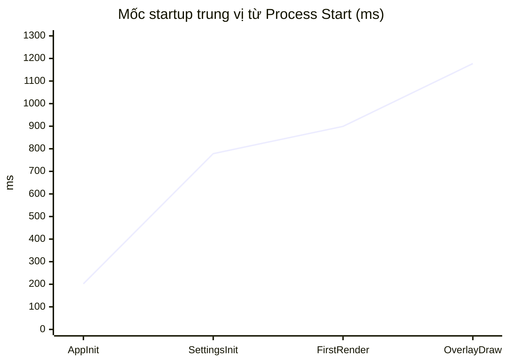

### Pha 3 — Cuộn Tab Chung trên ảnh nền, UI FPS cài đặt 60 so với 144

Hai cấu hình dùng cùng PNG 1600×900 và BlurRadius 10. Mỗi cấu hình chạy **3 lượt × 120 giây**, mỗi lượt gửi khoảng 758–761 `WM_MOUSEWHEEL` vào cửa sổ Settings, xác nhận 74 mức offset khác nhau. Dữ liệu: [60 FPS từng lượt](benchmarks/results/ui-scroll-60-20261026T082452Z-runs.csv), [60 FPS CPU/RAM tóm tắt](benchmarks/results/ui-scroll-60-20261026T082452Z-summary.csv), [144 FPS từng lượt](benchmarks/results/ui-scroll-144-20261026T083151Z-runs.csv), [144 FPS CPU/RAM tóm tắt](benchmarks/results/ui-scroll-144-20261026T083151Z-summary.csv); CSV `*-samples.csv` cùng tiền tố lưu từng mẫu. CPU là phần trăm **toàn bộ 16 bộ xử lý logic**, tính từ `Process.TotalProcessorTime`, không phải tải trên một core.

| UI FPS cài đặt | CPU TB từng lượt | Trung vị của 3 CPU TB | Process Private trung vị từng lượt | Trung vị của 3 giá trị Private | Offset xác nhận |
|---|---|---:|---|---:|---|
| 60 | 1,324%; 1,343%; 1,417% | **1,343%** | 255,168; 254,770; 256,389 MiB | **255,168 MiB** | 74/lượt |
| 144 | 1,306%; 1,389%; 1,463% | **1,389%** | 255,813; 255,287; 255,188 MiB | **255,287 MiB** | 74/lượt |

Chênh lệch trung vị CPU **+0,046 điểm phần trăm** nhỏ hơn biến thiên giữa các lượt; phép đo này không cho thấy cải thiện hoặc suy giảm chắc chắn khi đổi cài đặt. [SmoothScrollBehavior.cs](src/CrosshairOverlay/Controls/SmoothScrollBehavior.cs) giới hạn timer cuộn của Tab Chung **60 Hz khi có ảnh nền** qua `UseBackdropFrameBudget`; `UiTargetFps=144` không biến đường cuộn đó thành timer 144 Hz. Đây là nhịp timer ứng dụng, **không phải** FPS present của WPF/DWM.

WPR thử ghi CPU/GPU/DesktopComposition ETL nhưng Windows trả **`0xc5585011`** (“Failed to enable the policy to profile system performance”); phiên chạy công cụ không có `SeSystemProfilePrivilege`. Máy cũng không có Visual Studio Application Timeline/WPA để giải mã Measure, Arrange, Render. Vì vậy **P50/P95/P99 UI frame time, UI Thread Busy và layout pass = N/A** ở cả hai cấu hình; không biến CPU sample hoặc offset cuộn thành frame time. Không chấm tiêu chí 6,94 ms cho cấu hình 60 FPS, và không tuyên bố “60 FPS/144 FPS tuyệt đối”. [Lượt thử WPR thất bại nhưng cuộn hợp lệ](benchmarks/results/ui-scroll-60-20261026T082322Z-runs.csv) ghi `EtlCaptured=False`.

```text
Cuộn ảnh nền — CPU trung bình, % của 16 luồng logic (trung vị 3 lượt)
60 FPS cài đặt   1,343%  █████████████
144 FPS cài đặt  1,389%  ██████████████
Frame time P95/P99       N/A (không có ETL/WPF profiler hợp lệ)
```

### Pha 4 — GPU Process Memory, hiệu ứng và bounding box overlay

Ba lượt độc lập × 30 giây cho mỗi cấu hình: overlay vector tĩnh trong tray, Settings có ảnh nền, ảnh nền + Smart Contrast, và GIF hai khung 64×64 trên overlay. GIF tổng hợp có delay mặc định 0; renderer kẹp về tối thiểu **100 ms/khung**. Mỗi lượt có VMMap đầu phiên, 30 mẫu CPU/RAM cách khoảng 1 giây và 5 mẫu Windows `GPU Process Memory` cuối phiên. Dữ liệu: [VMMap 12 lượt](benchmarks/results/effect-profile-20261026T074703Z-vmmap-summary.csv), [CPU/RAM tóm tắt theo lượt](benchmarks/results/effect-profile-20261026T074703Z-summary.csv), [GPU từng mẫu](benchmarks/results/effect-profile-20261026T074703Z-gpu-memory.csv); CSV `*-samples.csv` cùng tiền tố có 360 mẫu gốc.

| Cấu hình | CPU TB theo lượt | Process Private trung vị 3 lượt | GPU Shared Usage trung vị 3 lượt | GPU Dedicated |
|---|---|---:|---:|---:|
| Overlay tĩnh | 0; 0; 0% | 191,412 MiB | 142,016 MiB | 0 MiB |
| Ảnh nền, Settings mở | 0; 0; 0% | 251,506 MiB | 166,887 MiB | 0 MiB |
| Ảnh nền + Smart Contrast | 0; 0; 0,033% | 250,135 MiB | 165,629 MiB | 0 MiB |
| GIF trên overlay | 0,033%; 0,033%; 0,033% | 191,442 MiB | 139,867 MiB | 0 MiB |

CPU 0 trong cửa sổ 1 giây là **dưới độ phân giải phép lấy mẫu**, không phải 0 chu kỳ. Các lượt ảnh nền có thêm Settings/UI đang mở, nên chênh RAM với overlay tĩnh **không tách riêng được ảnh nền khỏi Visual Tree**. Lượt thứ ba Smart Contrast có VMMap Private **191,629 MiB** và GPU Shared **104,469 MiB**, thấp hơn hai lượt cùng cấu hình khoảng 61 MiB; VMMap cho thấy một vùng Private Data ~61 MiB vắng mặt ở lượt này. Hai counter tương quan, nhưng chưa có allocation stack để gán vùng đó cho driver hoặc khẳng định Smart Contrast giải phóng nó.

[Ảnh chụp read-only HWND](benchmarks/results/overlay-bounds-20261026T042914Z.csv) đo overlay layered/click-through **35×35 pixel** trên màn hình **1536×864**, diện tích hình học **0,09231%** màn hình. Điều này xác nhận bounds nhỏ ở một trạng thái tĩnh; **không chứng minh DWM compositing cost giảm cùng tỷ lệ**, vì thiếu đối chứng cùng renderer với HWND toàn màn hình và counter per-HWND. `GPU Process Memory` là toàn tiến trình và trên máy này báo Shared Usage, không phải VRAM riêng của overlay.

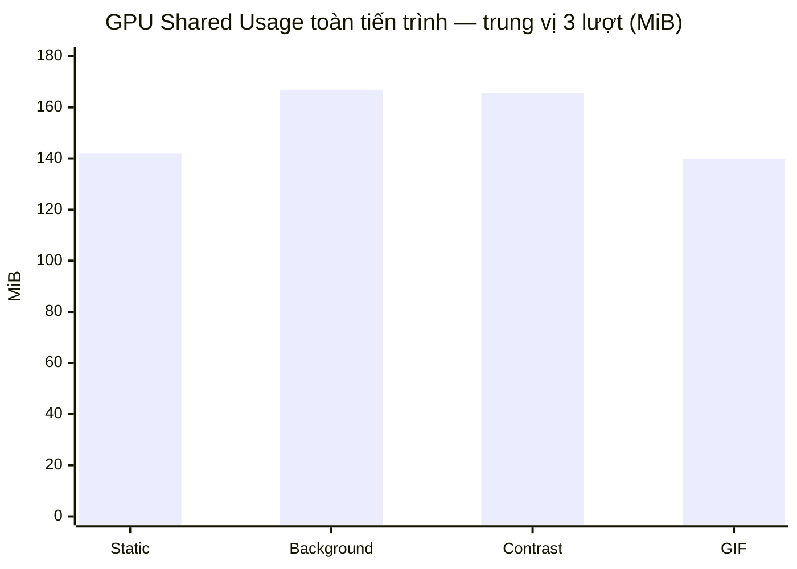

### Bài 500 preset — latency UI Automation và tài nguyên giữ lại

Script chọn luân phiên hai preset vector thực (`Diagonal X`, `Classic Cross`) bằng UI Automation, xác nhận mỗi lần chọn. Lượt 500 đầu có trung vị thời gian `SelectionItemPattern.Select()` **20,217 ms**, P95 **27,651 ms**, max **198,770 ms**; đây là thời gian gọi UI Automation, **không phải** độ trễ preset xuất hiện trên màn hình. [CSV 500 lượt](benchmarks/results/preset-switch-20261026T075818Z-selection-calls.csv), [VMMap trước/sau](benchmarks/results/preset-switch-20261026T075818Z-vmmap-summary.csv).

Sau 500 lượt, GDI tăng **46→117**, VMMap Private **247,465→257,590 MiB**. Lượt 500 độc lập khác cho GDI **46→113**, giữ **113 sau 60 giây**. Để kiểm tra tính lũy tiến, một tiến trình thứ ba chọn **1000 lần** và ghi [checkpoint mỗi 100 lượt](benchmarks/results/preset-switch-20261026T082041Z-checkpoints.csv): GDI dao động **71–117** thay vì tăng theo số lượt, sau 1000 lượt là **111** và sau 60 giây vẫn **111**. [VMMap lượt 1000](benchmarks/results/preset-switch-20261026T082041Z-vmmap-summary.csv) có thêm một vùng ~61 MiB xuất hiện giữa đầu/cuối, nên chênh Private Bytes của lượt đó không thể quy riêng cho preset switch. Kết luận hiện tại: có **retention/cache GDI ở mức cao hơn baseline**, nhưng **chưa thấy rò rỉ tuyến tính qua 1000 lần**; cần profiler GDI theo loại handle/stack trước khi đổi kiến trúc render.

### Stress GIF 60 phút — tài nguyên và xác minh hoạt ảnh

Lượt đầu chỉ có VMMap đầu phiên rồi bị ngắt trước khi có CSV đầy đủ, nên **không đưa vào thống kê**. Sau khi ứng dụng khác trên máy được đóng, lượt mới chạy trọn **3600,81 giây** trên binary Release x64 có SHA-256 managed DLL `18EE546E...`, với fixture GIF 2 khung 64×64 và Settings ẩn. Script [Profile-EffectVariants.ps1](benchmarks/Profile-EffectVariants.ps1) lưu checkpoint mỗi phút và hoàn tất [360 mẫu tài nguyên](benchmarks/results/effect-profile-20261026T153116Z-samples.csv), [bảng tóm tắt](benchmarks/results/effect-profile-20261026T153116Z-summary.csv), [VMMap đầu/cuối](benchmarks/results/effect-profile-20261026T153116Z-vmmap-summary.csv), [GPU counter cuối phiên](benchmarks/results/effect-profile-20261026T153116Z-gpu-memory.csv) và [metadata build](benchmarks/results/effect-profile-20261026T153116Z-metadata.json).

| Chỉ số | Đầu phiên / 5 phút đầu | Giữa phiên (phút 27,5–32,5) | 5 phút cuối / cuối phiên | Nhận xét |
|---|---:|---:|---:|---|
| Process Private, trung vị từng đoạn | 192,176 MiB | 198,055 MiB | 197,992 MiB | Tăng trong warmup; giữa→cuối **−0,063 MiB** |
| Working Set, trung vị từng đoạn | 263,004 MiB | 270,891 MiB | 270,891 MiB | Đi ngang sau warmup trong cửa sổ đã đo |
| GDI handles | 33 | 33 | 33 | Không tăng trong 360 mẫu |
| USER handles, trung vị | 25 | 25 | 25 | Dao động 24–27 |
| VMMap Private | 190,953 MiB | Không chụp | 194,758 MiB | Tăng **3,805 MiB** từ snapshot đầu, gồm cả warmup |
| VMMap Managed Heap private | 6,824 MiB | Không chụp | 15,391 MiB | Trang private GC tăng **8,567 MiB**; không phải live heap |
| GPU Shared Usage toàn tiến trình | Không đo đầu phiên | Không đo | 139,7891 MiB ở 5 mẫu cuối | Không có chuỗi VRAM cả giờ; Dedicated counter 0 |

Cả **360 mẫu CPU/10 giây** đều trả 0% theo `Process.TotalProcessorTime` chuẩn hóa 16 luồng logic. Đây là **dưới độ phân giải phép đo**, không phải bằng chứng không có CPU wakeup hoặc GPU work. Private Bytes toàn phiên có trung vị **197,977 MiB**, khoảng **189,801–199,047 MiB**; giá trị đầu thấp hơn vì warmup. VMMap `Private Data` từ **134,488→133,074 MiB**, native `Heap` từ **26,156→23,195 MiB**. Không thấy leak GDI hay tăng Private đều sau warmup trong **một lượt GIF cô lập**; chưa chứng minh mọi GIF, Smart Contrast, game hoặc phiên dài hơn đều ổn định.

Fixture có 2 khung theo `GifBitmapDecoder`, preset active trỏ đúng file GIF và overlay HWND hiện trong suốt lượt. Để kiểm tra hoạt ảnh thay vì suy từ đuôi file, hai **lượt chẩn đoán riêng 20 giây** trên cùng fixture bật `CROSSGOVERLAY_BENCHMARK_GIF_PROBE=1`: bộ phát khung ghi 100 timer ticks trong [10,8675 giây](benchmarks/results/gif-frame-probe-20261026.csv) và [10,8812 giây](benchmarks/results/gif-frame-probe-20261026T164308Z.csv). [Script probe](benchmarks/Probe-GifPlayback.ps1) tái lập phép đo; [metadata](benchmarks/results/gif-frame-probe-20261026T164308Z-metadata.json) ghi DLL hash `105A27B0...`, khác bản đo 60 phút vì chỉ thêm bộ đếm có điều kiện. Tick đổi `ImageSource` nhưng không phải số frame đã present bởi DWM. Điều này xác nhận đường phát GIF của fixture hoạt động trong lượt probe; lượt 60 phút không có counter từng khung, nên không suy ra chính xác số frame nó đã trình bày. Đọc pixel bằng `PrintWindow` chỉ thu màu đen từ HWND layered WPF trên máy này, không được dùng để kết luận ảnh tĩnh.

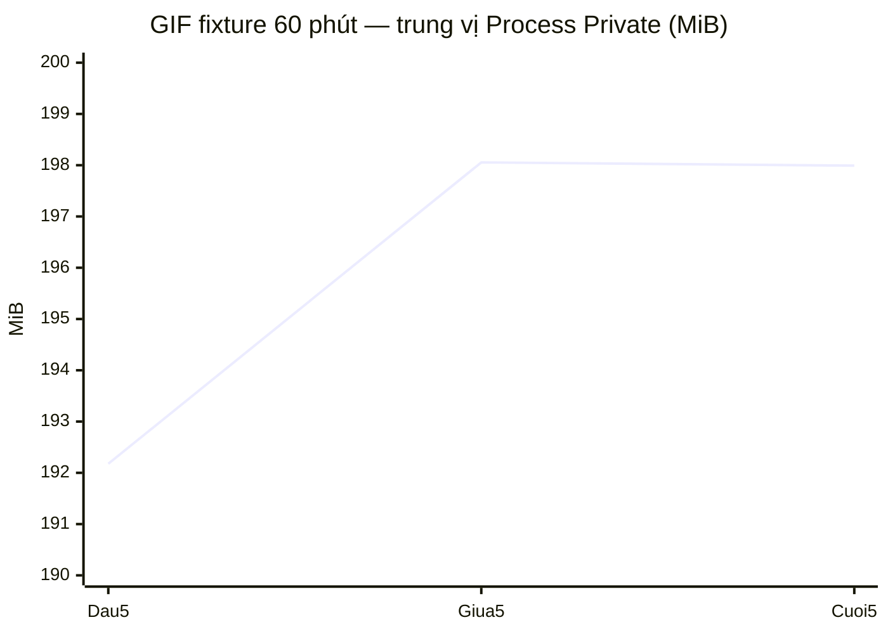

### Đánh giá sau profiling và khả năng kết luận

| Câu hỏi | Bằng chứng hiện có | Kết luận hợp lệ |
|---|---|---|
| Private Bytes khoảng 220–240 MiB đến từ đâu? | VMMap phân nhóm, hai vùng Private Data 61,039 MiB/vùng, không có allocation stack | Chưa quy được vùng đó cho CLR, WPF hay driver; ngưỡng 120 MiB không đạt trong các phiên này |
| Mở Settings ảnh hưởng tốc độ xuất hiện tâm ngắm? | Mốc drawing đầu tiên: trung vị 1177,356 ms khi mở Settings, 667,192 ms khi vào tray | Hai đường khởi động khác tải; có tương quan, chưa có thử nghiệm cô lập layout hay DWM present để xác định nguyên nhân |
| Cuộn nền ảnh ở 144 có P95/P99 thấp hơn 60? | 3 × 120 giây mỗi cấu hình, CPU/RAM/offset hợp lệ; ETW bị từ chối | Không thể xếp hạng độ mượt theo frame time hoặc Measure/Arrange; CPU chênh nhỏ hơn độ biến thiên lượt đo |
| Bounding box overlay nhỏ có giảm DWM cost? | HWND 35×35 trên 1536×864, GPU counter toàn tiến trình | Chưa đo chi phí DWM theo HWND hoặc bản đối chứng full-screen cùng renderer |
| Có leak khi mở/ẩn Settings hoặc đổi preset? | 100 chu kỳ + 60 phút idle GDI 47→47, USER 44→41; 1000 preset GDI dao động 71–117 | Không thấy tăng tuyến tính trong các cửa sổ quan sát; chưa chứng minh ổn định mọi cấu hình/phiên dài |
| Hiệu ứng GIF ổn định trong 60 phút? | Một lượt fixture GIF đủ 3600,81 giây, GDI 33 suốt 360 mẫu, Private đi ngang sau warmup; probe riêng xác nhận 100 frame ticks | Không thấy tăng tuyến tính trong fixture này; thiếu frame counter liên tục và nhiều lượt độc lập |

**Phạm vi kiểm tra mã:** Chỉ thêm chẩn đoán startup/GIF có điều kiện và script benchmark. Không thay renderer, bố cục, kiểu chữ `Ideal`, màu Card `#D9111B22`, hoặc logic dịch vụ trên cơ sở các số đo còn thiếu. `dotnet build Crosshair.sln -c Release -p:Platform=x64 --no-restore` đạt 0 warning/0 error; `dotnet test Crosshair.sln -c Release -p:Platform=x64 --no-build` đạt **801 pass, 1 skip, 0 fail**. Các script PowerShell trong `benchmarks/` đã qua kiểm tra cú pháp. Bài Raw Input bị skip vì cần thiết bị chuột vật lý.

**Phép đo còn thiếu trước khi tối ưu sâu:** (1) allocation stack cho hai vùng Private Data lớn và phân loại GDI handle; (2) ETW/Application Timeline đủ quyền để lấy UI P50/P95/P99 cùng Measure/Arrange/Render; (3) đo GPU/DWM per-HWND hoặc A/B tương đương; (4) nhiều lượt dài hạn với GIF khác/Smart Contrast và Managed Heap live; (5) frame CSV Delta Force từ phương pháp đã được nhà phát hành xác nhận cho phép. Không gọi `GC.Collect()` hay `SetProcessWorkingSetSize()` để làm đẹp Private Bytes vì VMMap chưa chứng minh phần giữ lại là rác có thể thu hồi.

**Tái chạy ngoài game** (đóng bản app đang chạy vì mutex single-instance; VMMap cần có trong `benchmarks/tools/VMMap/`):

```powershell
dotnet build .\Crosshair.sln -c Release -p:Platform=x64 --no-restore
powershell -NoProfile -ExecutionPolicy Bypass -File .\benchmarks\Prepare-EffectFixtures.ps1
powershell -NoProfile -ExecutionPolicy Bypass -File .\benchmarks\Profile-MemoryStates.ps1 -Cycles 100 -IdleSeconds 3600
powershell -NoProfile -ExecutionPolicy Bypass -File .\benchmarks\Profile-UiScroll.ps1 -UiFps 60 -Runs 3 -DurationSeconds 120 -TraceRuns 0
powershell -NoProfile -ExecutionPolicy Bypass -File .\benchmarks\Profile-UiScroll.ps1 -UiFps 144 -Runs 3 -DurationSeconds 120 -TraceRuns 0
powershell -NoProfile -ExecutionPolicy Bypass -File .\benchmarks\Profile-EffectVariants.ps1 -Variant gif -Runs 1 -DurationSeconds 3600 -SampleSeconds 10
powershell -NoProfile -ExecutionPolicy Bypass -File .\benchmarks\Probe-GifPlayback.ps1 -WaitSeconds 20
```

`-TraceRuns 0` tái lập chuỗi cuộn CPU/RAM; chỉ bật ETW sau khi máy có quyền profiler hợp lệ. Các script từ chối chạy khi phát hiện Delta Force và chỉ thao tác tiến trình benchmark của chính chúng.

## Điều tra tiếp ngày 2026-10-27 — startup, Private Data, GDI và GPU cùng tiến trình

**Phạm vi:** Release x64, ngoài game, không gắn debugger. Bản mới chỉ đổi thứ tự bootstrap: nạp preset, khởi tạo overlay, bắt foreground, áp quy tắc hiện/ẩn và hành vi trước; nhường Dispatcher cho lượt vẽ overlay; sau đó mới dựng Splash/Settings và khởi tạo tray, hotkey, OBS. `StatsService.StartAsync()` vẫn hoàn tất trước watcher để không bỏ sót lần đổi preset đầu. Không đổi renderer, cache preset, kiểu chữ hoặc Card. [10 lượt startup sau refactor](benchmarks/results/20261027T155731Z-StartupDecoupledFinal-runs.json) và [5 lượt baseline cùng fixture](benchmarks/results/20261027T154039Z-StartupBeforeOverlayFirst-runs.json) được đo bằng `BenchmarkTimeline` trong bản Release; đây là mốc **WPF DrawingVisual callback**, chưa phải xác nhận DWM present/photodiode.

| Mốc từ Process Start | Trước (trung vị 5 lượt) | Sau (trung vị 10 lượt) | Diễn giải |
|---|---:|---:|---|
| Overlay first drawing | 1.158,436 ms | **694,899 ms** | Sớm hơn 463,537 ms theo hai tập lượt đo; 1/10 lượt sau đạt ≤650 ms, nên **chưa đạt mục tiêu ổn định** |
| Settings first render | 846,964 ms | 1.049,239 ms | Settings hiện muộn hơn để nhường đường vẽ overlay |

Các lượt overlay sau refactor nằm trong **630,529–734,015 ms**; cả 10 lượt đều có `OverlayFirstDrawing < SettingsFirstRender`. Một bản trung gian có Splash trước overlay đạt trung vị 839,768 ms/5 lượt; số này không được dùng làm kết quả cuối. [Đường startup tray-only](benchmarks/results/effect-profile-20261027T160453Z-vmmap-summary.csv) cũng hoàn tất 1/1 lượt kiểm tra hồi quy. Lỗi `H.NotifyIcon.TryCreate failed` ở các lượt thử sandbox là do phiên công cụ không được truy cập shell; các lượt desktop được cấp quyền chạy đủ 10/10 và không đưa lượt lỗi sandbox vào thống kê.

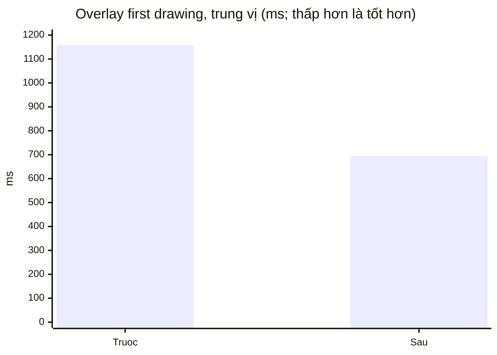

### Hai vùng Private Data 61,039 MiB: điều kiện kích hoạt và giới hạn phân loại

VMMap trước đó thấy hai vùng **62.504 KiB/vùng** trong chế độ khởi động tray có toast. Phép A/B mới dùng **cùng một PID cho mỗi chuỗi** `Settings hiện → ẩn 30 giây → mở lại`, cùng ảnh nền, 60 giây warmup, 5 mẫu GPU/trạng thái, và VMMap ở mỗi trạng thái. Lượt bình thường: [CSV GPU](benchmarks/results/gpu-settings-20261027T155811Z-samples.csv), [metadata](benchmarks/results/gpu-settings-20261027T155811Z-metadata.json). Lượt kiểm soát chỉ tắt toast bằng cờ benchmark: [CSV GPU](benchmarks/results/gpu-settings-20261027T160144Z-samples.csv), [metadata](benchmarks/results/gpu-settings-20261027T160144Z-metadata.json). CSV VMMap chi tiết nằm trong `benchmarks/results/vmmap/` (gitignored) theo cùng mã thời gian.

| Điều kiện | GPU Shared toàn tiến trình khi Settings hiện / ẩn / mở lại | VMMap Private Data khi Settings hiện / ẩn / mở lại | Vùng mới 62.504 KiB khi ẩn |
|---|---|---|---|
| Toast bình thường | 105,809 / **168,734** / 167,555 MiB | 96.632 / **161.248** / 159.704 KiB | Có, giữ lại sau khi toast tự đóng |
| Chỉ tắt toast trong tiến trình benchmark | 105,777 / **105,777** / 106,195 MiB | 96.568 / **96.560** / 97.028 KiB | Không |

**Kết luận được hỗ trợ:** đường tạo toast lần đầu là **điều kiện kích hoạt vùng Private Data thứ hai** trên máy đo này; việc chỉ ẩn Settings không làm vùng đó xuất hiện. Vùng thứ nhất đã có khi Settings còn hiện và khi chưa tạo toast. Dữ liệu A/B không chỉ ra hàm native cấp phát hay chứng minh vùng thứ nhất thuộc CLR, WPF hoặc driver; nhãn `Thread Environment Block` ở dòng con VMMap không phải allocation stack đáng tin để quy chủ sở hữu. `GPU Process Memory` là toàn tiến trình, không đo riêng HWND/DWM. Vì vậy **không thể kết luận rằng ẩn Settings làm giảm GPU Shared**, dù lớp ảnh nền đã bị ngắt render; không thay cache, `GC.Collect()` hoặc `SetProcessWorkingSetSize()` chỉ để hạ số đo.

### Phân loại GDI sau 1.000 lượt đổi preset

[GDIView theo loại](benchmarks/results/preset-switch-20261027T155259Z-gdi-types.csv), [checkpoint mỗi 100 lượt](benchmarks/results/preset-switch-20261027T155259Z-checkpoints.csv) và [VMMap trước/sau/sau 60 giây](benchmarks/results/preset-switch-20261027T155259Z-vmmap-summary.csv) đều từ cùng một tiến trình Release x64. GDIView được tải từ [trang chính thức của NirSoft](https://www.nirsoft.net/utils/gdi_handles.html); chỉ dùng các cột loại handle và `All GDI` khớp `GetGuiResources`, không dùng cột `GDI Total` của bản xuất dòng lệnh vì nó trả 0 không nhất quán với các cột còn lại.

| Loại / tổng | Trước | Sau 1.000 lượt | Sau 60 giây |
|---|---:|---:|---:|
| Region | 12 | **46** | **46** |
| Brush / Bitmap / Font / DC | 3 / 4 / 3 / 5 | 3 / 4 / 3 / 5 | 3 / 4 / 3 / 5 |
| `GetGuiResources` / All GDI | 47 | **81** | **81** |

Checkpoint dao động **77–121** (có lượt vượt 117 và 120), cuối 1.000 lượt về 81. Dữ liệu mới bác bỏ khẳng định “LRU cache GDI cố định trần 117”; nó cho thấy **Region retention sau warmup** nhưng chưa chứng minh leak tăng đều hoặc chủ sở hữu Region. Mã ứng dụng không có cache GDI Brush/Pen trong `CrosshairVisualHost`; thêm `MaxCachedHandles=120` hay hủy Region theo tổng handle sẽ xử lý sai lớp tài nguyên. Cần trace handle/call stack hoặc test nhiều vòng độc lập trước khi sửa cơ chế hủy.

### ETW / WPF UI frame time chưa lấy được

[Biên bản quyền profiler](benchmarks/results/profiler-access-20261027.txt) ghi `wpr -start VirtualAllocation -filemode` bị `0x80070005` và `wpr -start DesktopComposition -start GPU -filemode` bị `0xc5585011`; `wpr -status` xác nhận không có phiên ghi dang dở. Phiên công cụ không có `SeSystemProfilePrivilege`, đồng thời chưa có WPA/WinDbg/PerfView để giải mã stack. Theo [hướng dẫn VirtualAllocation của Microsoft](https://learn.microsoft.com/en-us/windows/apps/develop/performance/disk-memory), cần terminal Administrator để ghi commit stack và WPA để đọc `Commit Stack`. [Danh mục profile WPR của Microsoft](https://learn.microsoft.com/en-us/windows-hardware/test/wpt/built-in-recording-profiles) dùng tên `GPU` và `DesktopComposition`; ví dụ `WPF`/`DWM` trong yêu cầu không phải tên profile tích hợp trên máy này.

Do **không có ETL hợp lệ**, allocation call stack cho hai vùng 61 MiB, `Measure`/`Arrange`/`Render`, UI P95/P99 ở 60 hoặc 144 FPS, và DWM compositing cost theo từng HWND đều là **N/A**. Các phép cuộn CPU/offset ở phần trước không được đổi tên thành frame time. Cần chạy lại `Profile-UiScroll.ps1 -TraceRuns 1` từ terminal thực sự có quyền system profiling, lấy ETL và phân tích bằng WPA hoặc Visual Studio Application Timeline trước khi tối ưu UI tiếp.

## Điều tra tiếp ngày 2026-10-27 — Toast, Region và quyền ETW

Các phép đo dưới đây chạy **ngoài game**, Release x64, không debugger và dùng thư mục dữ liệu benchmark cô lập. Cả hai đường Toast A/B, 50 Toast, đổi preset nội bộ/UI Automation và 30 lượt startup xen kẽ đều dùng **cùng một binary** SHA-256 `7DA83E403D86A05D2781EE03BFEB23E34235B2598045B9A8D24F60EC2B94C310` (`CrossGOverlay.dll`: `2F83AE08F720F244CFA590719FD2B349E6ED8591D35B8030CE06E633892FDD6C`). `VMMap Private Data` là bộ nhớ private được VMMap phân loại; `GPU Shared` là counter **toàn tiến trình**, không phải bộ nhớ riêng HWND Toast.

### 1. Vùng 62.504 KiB xuất hiện khi Toast tạo HWND đầu tiên

Script [Profile-DiagnosticScenario.ps1](benchmarks/Profile-DiagnosticScenario.ps1) dùng tín hiệu `ready/start/done` để chụp cùng PID trước/sau workload, rồi đo lại khi Toast cuối đã đóng. Bài 10 lượt dùng [Toast bình thường](benchmarks/results/diagnostic-toast-20261027T162404Z-snapshots.csv) và [Toast không DropShadowEffect](benchmarks/results/diagnostic-toast-20261027T162307Z-snapshots.csv), **cùng binary**; chế độ không bóng chỉ bật bởi biến môi trường trong fixture benchmark, giao diện phát hành giữ nguyên. Bài [50 lượt Toast bình thường](benchmarks/results/diagnostic-toast-20261027T162808Z-snapshots.csv) có [checkpoint mỗi 10 lượt](benchmarks/results/diagnostic-toast-20261027T162808Z-checkpoints.csv). Workload gọi đường sản phẩm `ShowNotification`: Toast trước `Close()`, Toast mới `Show()`, mỗi 300 ms; không phải thử nghiệm pool `Hide()/Show()`.

| Điều kiện | VMMap Private Data trước → sau ổn định (MiB) | GPU Shared trước → sau ổn định (MiB) | Vùng Private Data 62.504 KiB trước → sau | GDI Region trước → sau |
|---|---:|---:|---:|---:|
| 10 Toast chuẩn | 93,969 → 153,414 (**+59,445**) | 105,453 → 164,652 (**+59,199**) | 1 → 2 | 12 → 13 |
| 10 Toast không shadow, cùng binary | 94,344 → 152,492 (**+58,148**) | 105,773 → 163,562 (**+57,789**) | 1 → 2 | 12 → 12 |
| 50 Toast chuẩn | 94,352 → 155,875 (**+61,523**) | 105,781 → 166,703 (**+60,922**) | 1 → 2 | 12 → 13 |

Khi chỉ bỏ shadow, vùng thứ hai **vẫn xuất hiện** và GPU Shared tăng gần như cùng mức; `DropShadowEffect` không phải nguyên nhân duy nhất. 50 lượt không tạo vùng 62.504 KiB thứ ba; GPU Shared checkpoint ở lượt 10/20/30/40/50 lần lượt **165,184 / 165,965 / 169,414 / 167,266 / 166,703 MiB**, không tăng đều. Sau 15 giây, GPU Shared vẫn 166,703 MiB và GDI Region còn 13. Đây là bằng chứng **retention có giới hạn trong 50 lượt của fixture này**, chưa phải chứng minh allocator WPF, D3D9Ex, driver hay swapchain. Vùng VMMap có kích thước **62.504 KiB ≈ 61,039 MiB**; nhãn con `Thread Environment Block` không phải allocation call stack. **Chưa có stack cấp phát**, nên không thay `ToastWindow` sang singleton/pool, không ép GC và không trim Working Set.

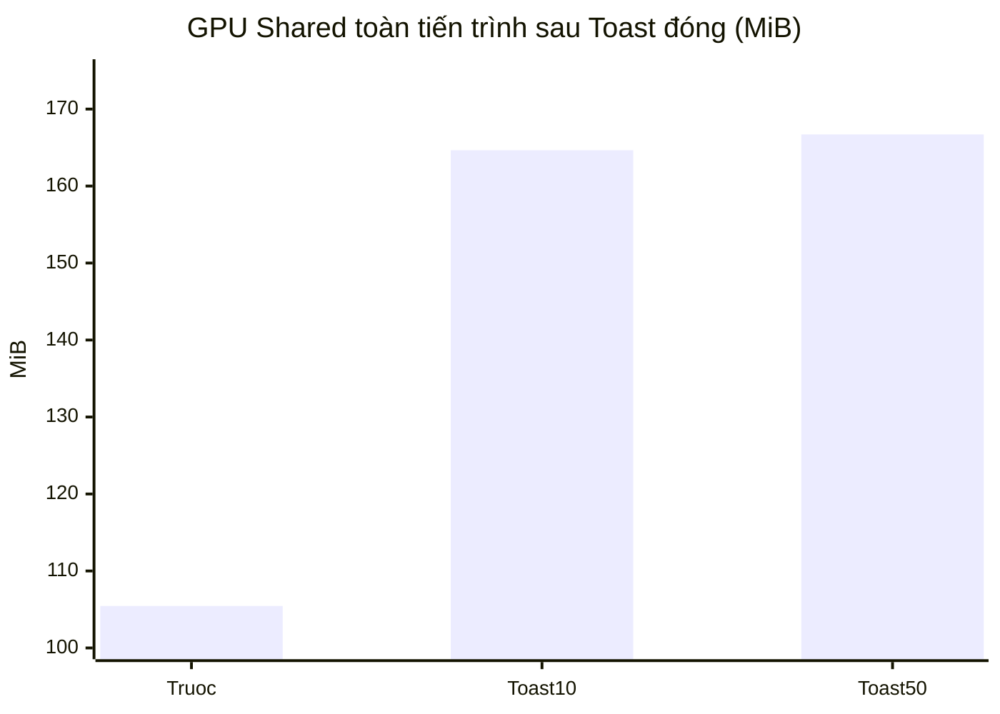

### 2. Đối chứng GDI Region: UI Automation và lệnh nội bộ

Hai đường dùng cùng fixture và cùng DLL. Đường [UI Automation](benchmarks/results/preset-switch-20261027T162625Z-gdi-types.csv) chọn mục trong danh sách preset bằng `SelectionItemPattern.Select`; đường [lệnh nội bộ](benchmarks/results/diagnostic-preset-20261027T162122Z-snapshots.csv) gọi `IPresetLibrary.SetActive` trên Dispatcher của chính app. Mỗi đường đổi 1.000 lần, VMMap/GDIView chụp trước, sau và sau 30 giây; [checkpoint nội bộ](benchmarks/results/diagnostic-preset-20261027T162122Z-checkpoints.csv) và [checkpoint UI Automation](benchmarks/results/preset-switch-20261027T162625Z-checkpoints.csv) lưu theo tiến độ.

| Đường đổi preset | Region trước → sau → sau 30 s | Tổng GDI trước → sau → sau 30 s | Brush / Bitmap / Font / DC |
|---|---:|---:|---|
| UI Automation | 12 → **66 → 66** | 47 → **101 → 101** | 3 / 4 / 3 / 5, không đổi |
| `IPresetLibrary.SetActive` nội bộ | 12 → **36 → 36** | 47 → **71 → 71** | 3 / 4 / 3 / 5, không đổi |

Đường nội bộ **cũng** làm Region tăng; vì vậy UI Automation peer không phải nguồn duy nhất. Chênh lệch cuối 66 so với 36 xảy ra trong **hai tiến trình riêng** với thứ tự/scheduling khác nhau, không phải phép quy 30 Region trực tiếp cho UI Automation. Tổng GDI theo checkpoint nội bộ dao động **55–152**, rồi về 71; đường UI Automation dao động **77–99**, rồi 101. Không có tăng tuyến tính theo số lượt trong cửa sổ thử, và không có cơ sở đặt `MaxCachedHandles=120`. Rà soát mã app không thấy `Create*Rgn`/`SetWindowRgn`/`DeleteObject` trực tiếp; `ScreenColorSamplerService` có `GetDC` đi kèm `ReleaseDC` trong `finally`. Nguồn cấp phát Region bên dưới WPF/Windows vẫn **chưa xác định bằng handle stack**.

### 3. ETW elevated và UI frame time

Đã thử kiểm tra token cả trong lẫn ngoài sandbox: mức **Medium Integrity**, `BUILTIN\\Administrators` ở trạng thái **deny only**, không có `SeSystemProfilePrivilege`. Script [Collect-ElevatedEtw.ps1](benchmarks/Collect-ElevatedEtw.ps1) vì vậy dừng **trước khi gọi WPR** với thông báo cần PowerShell Administrator; các lần gọi WPR trước đó trả `0x80070005` và `0xc5585011`. Không có WPA/WinDbg/PerfView cài ở các đường dẫn chuẩn trên máy này. Script có ba chế độ `ToastAllocation`, `Ui60`, `Ui144`; dùng tên profile WPR hiện có (`VirtualAllocation`, `CPU`, `GPU`, `DesktopComposition`), không dùng `WPF`/`DWM` vì `wpr -profiles` trên máy không liệt kê chúng. Với `ToastAllocation`, mở ETW **trước** khi khởi chạy app/Toast để bắt `VirtualAlloc Commit Stack`; WPA cần đối chiếu PID, khoảng thời gian và địa chỉ 62.504 KiB từ VMMap. Với `Ui60`/`Ui144`, WPA hoặc Visual Studio Application Timeline phải tách frame của **app** với present của **DWM**; trace CPU/GPU/DWM tự nó không tự cho biết `Measure`/`Arrange` nếu thiếu sự kiện WPF tương ứng.

Theo [Microsoft WPR recording profiles](https://learn.microsoft.com/en-us/windows-hardware/test/wpt/built-in-recording-profiles) và [hướng dẫn bộ nhớ/WPA](https://learn.microsoft.com/en-us/windows/apps/develop/performance/disk-memory), cần quyền Administrator thực sự cho trace system-level và đọc commit stack. Do thiếu ETL, **allocation stack, UI Measure/Arrange/Render, P95/P99 UI frame time ở 60/144 FPS, DWM Present và chi phí compositing của HWND đều N/A**. Không lấy nhịp callback hay CPU mẫu thay cho frame time. Lưu ý script UI scroll hiện có giới hạn nhịp cuộn về 60 FPS khi ảnh nền bật, dù cài đặt UI là 144; hai chế độ này **không phải** phép A/B 60 so với 144 khung cuộn thực tế cho đến khi workload và trace chứng minh khác biệt.

Chạy từ **PowerShell Administrator** trên desktop ngoài game, sau khi cài Windows Performance Toolkit/WPA và đóng mọi CrossGOverlay khác:

```powershell
powershell -NoProfile -ExecutionPolicy Bypass -File .\benchmarks\Collect-ElevatedEtw.ps1 -Scenario ToastAllocation
powershell -NoProfile -ExecutionPolicy Bypass -File .\benchmarks\Collect-ElevatedEtw.ps1 -Scenario Ui60 -DurationSeconds 30
powershell -NoProfile -ExecutionPolicy Bypass -File .\benchmarks\Collect-ElevatedEtw.ps1 -Scenario Ui144 -DurationSeconds 30
```

### 4. Startup xen kẽ: WPF first drawing, chưa phải DWM Present

[Profile-StartupModes.ps1](benchmarks/Profile-StartupModes.ps1) sao chép cùng fixture preset/cấu hình ra hai thư mục benchmark chỉ khác `StartMinimizedToTray`, rồi khởi động Tray/Settings **xen kẽ** 15 cặp. [CSV từng lượt](benchmarks/results/startup-modes-20261027T162541Z-runs.csv) và [bảng P95/P99 nearest-rank](benchmarks/results/startup-modes-20261027T162541Z-summary.csv) ghi lại mốc `CrosshairVisualHost.OnRender` tính từ lúc process start. Bộ đo đầu tiên luôn chứa ảnh hưởng warmup/cache và được giữ nguyên trong thống kê; 15 lượt mỗi mode là **repeated starts trong cùng boot**, không có 5 lượt cold đã xác minh.

| Mode | n | Trung vị WPF first drawing | P95/P99 nearest-rank | Min–max | DWM Present |
|---|---:|---:|---:|---:|---|
| Tray | 15 | **594,484 ms** | **1.037,485 / 1.037,485 ms** | 499,705–1.037,485 ms | N/A |
| Settings | 15 | **549,916 ms** | **950,165 / 950,165 ms** | 499,703–950,165 ms | N/A |

Trong mode Settings, overlay vẽ trước `SettingsFirstRender` **15/15 lượt**; trung vị render đầu của Settings **888,274 ms**. Với n=15, nearest-rank P95/P99 cùng rơi vào **giá trị lớn nhất**, rất nhạy với một outlier; không dùng số này để tuyên bố đạt mục tiêu latency. [Tài liệu WPF của Microsoft](https://learn.microsoft.com/en-us/dotnet/desktop/wpf/graphics-multimedia/how-to-render-on-a-per-frame-interval-using-compositiontarget) xác nhận `CompositionTarget.Rendering` chạy trong pipeline WPF, sau layout và trước khi nội dung được render; nó **không** là timestamp DWM swap/present. Mốc hiện có `OnRender` cũng không chứng minh đã thấy pixel trên màn hình. Cần ETW/DWM hoặc phương pháp đo hiển thị độc lập cho `T_DWM_Present`; cold start đòi hỏi quy trình reboot/cache độc lập, nên các ô đó tiếp tục N/A.

Fixture so sánh xen kẽ này không có ảnh nền và khác fixture của phép đo startup trung vị 694,899 ms ở phần trước; **không** coi chênh lệch giữa hai tập là cải thiện do code mới. Chế độ ảnh nền/tải hệ thống, thứ tự khởi chạy và cache đều có thể ảnh hưởng kết quả.

**Quyết định sau số đo:** Chỉ thêm probe được khóa bằng biến môi trường benchmark và script/CSV; không sửa renderer, Toast pooling, cache, GC policy, font `Ideal` hay màu Card `#D9111B22` khi chưa có allocation/handle stack. Build Release x64 **0 warning/0 error**; **801 test pass, 1 skip** (Raw Input cần chuột vật lý). Các script mới qua kiểm tra cú pháp PowerShell.

## ETW elevated ngày 2026-10-29 — Toast, GDI và UI Present

Phần này **cập nhật** nhận định lịch sử ngày 27/10 rằng chưa có ETL. [Collect-ElevatedEtw.ps1](benchmarks/Collect-ElevatedEtw.ps1) đã chạy trong PowerShell Administrator thực sự (`PHELANUX\PhelanUX`), ngoài game và không gắn debugger. `wpr -profiles` trên máy không có tên `WPF` hoặc `DWM`; script dùng `VirtualAllocation`, `CPU.light`, `GPU.light`, `DesktopComposition.light`, `Handle`, và riêng Win32k dùng keyword `GdiHandleOperation`. Microsoft PerfView bản có chữ ký hợp lệ được dùng để giải mã ETL và call stack. Mọi phép đo dưới đây dùng ứng dụng Release x64 và dữ liệu fixture benchmark; **không thay đổi C#/XAML của ứng dụng** trong đợt này.

### 1. Vùng Private Data 62.504 KiB khi Toast xuất hiện

[Toast ETL](benchmarks/results/etl/CrossGOverlay-ToastAllocation-20261029T031115Z.etl) ghi PID **30480**, không mất event theo TraceLog. [VMMap/GPU cùng PID](benchmarks/results/diagnostic-toast-20261029T031116Z-snapshots.csv) đo Private Data **94,348→153,641 MiB** và GPU Shared **105,777→164,953 MiB** sau 10 Toast. ETW ghi hai lần `MEM_RESERVE` và `MEM_COMMIT` cùng độ dài `0x03D0A000 = 62.504 KiB` tại `6.770,6 ms` và `23.137,9 ms` từ đầu trace; vùng thứ hai có base `0x000001DF93170000` và xuất hiện trong giai đoạn Toast đầu tiên. Hai vùng được decommit/release khi tiến trình kết thúc, không phải ngay lúc Toast đóng.

Stack `MEM_COMMIT` của **vùng thứ hai** có chuỗi module theo chiều caller → allocator:

```text
wpfgfx_cor3.dll (WPF native renderer)
  → d3d9.dll → d3d9on12.dll → d3d12core.dll
  → igd12um64xel.dll (Intel user-mode graphics driver)
  → win32u.dll → dxgkrnl.sys / dxgmms2.sys → ntoskrnl.exe
```

Đây là bằng chứng trực tiếp vùng 61,039 MiB được cấp phát **qua đường đồ họa WPF–Direct3D–driver Intel**, không phải một mảng managed của CLR. Trace module-level chưa xác định đối tượng đồ họa cụ thể (surface, backing allocation hay resource khác); không gán riêng cho DWM swapchain hoặc `DropShadowEffect`. Đối chứng bỏ shadow trước đây vẫn sinh vùng này. Vì vậy **không pool/xóa Toast, không ép GC hoặc trim Working Set** dựa trên số Private Bytes.

### 2. GDI Region khi đổi preset nội bộ

Profile WPR `Handle` trong [ETL 1.000 preset](benchmarks/results/etl/CrossGOverlay-PresetRegion-20261029T033909Z.etl) chỉ ghi `Object/CreateHandle` của **kernel handle**, không có sự kiện tạo GDI HRGN; [GDIView cùng PID](benchmarks/results/diagnostic-preset-20261029T033909Z-snapshots.csv) vẫn cho Region **12→102**. Do đó đã chạy thêm provider `Microsoft-Windows-Win32k` với keyword `GdiHandleOperation` và trace **0 event lost**:

| Lượt nội bộ | ETL | Win32k `HandleType=4` Create / Destroy trong cửa sổ thao tác | Region GDIView trước → sau | Stack |
|---|---|---:|---:|---|
| 1.000 preset | [Win32k events](benchmarks/results/etl/CrossGOverlay-PresetGdiEvents-20261029T035221Z.etl) | **59.875 / 59.795**, ròng **+80** | [12→92](benchmarks/results/diagnostic-preset-20261029T035222Z-snapshots.csv) | Không bật stack |
| 100 preset | [Win32k + stack](benchmarks/results/etl/CrossGOverlay-PresetGdiStacks-20261029T035747Z.etl) | **5.998 / 5.960**, ròng **+38** | [12→50](benchmarks/results/diagnostic-preset-20261029T035748Z-snapshots.csv) | **5.998/5.998 Create có stack** |

`HandleType=4` trùng chính xác biến thiên Region GDIView trong **hai** lượt độc lập. Trace stack có 371.386 event, 0 lost. Trong cửa sổ 100 preset, khi theo dõi `HandleValue` qua Create/Destroy/Transform, có 44 handle tạo mới chưa có Destroy trước snapshot settled và 6 Destroy của handle tạo trước cửa sổ; ròng **+38**. Cả 44 stack tạo handle còn thấy tại cuối cửa sổ đều đi qua `wpfgfx_cor3.dll → gdi32.dll → win32u.dll → win32k*.sys`; một số stack tạo khác đi qua `WindowsBase.dll`/`PresentationCore.dll`/`PresentationFramework.dll`. Như vậy nguồn tạo Region quan sát được nằm trong **đường render/clip WPF native**, không thấy lệnh `CreateRectRgn` trực tiếp của app trên các stack đã phân loại. Stack chưa có tên hàm/PDB đầy đủ và một cửa sổ 100 preset chưa phân biệt cache WPF có giới hạn với retention dài hạn; không đặt ngưỡng hủy GDI tùy ý.

### 3. UI Present khi cuộn Tab Chung có ảnh nền

[UI 60 ETL](benchmarks/results/etl/CrossGOverlay-Ui60-20261029T031507Z.etl) và [UI 144 ETL](benchmarks/results/etl/CrossGOverlay-Ui144-20261029T031626Z.etl) đều hợp lệ, **0 event lost**. Mỗi lượt [fixture 60](benchmarks/results/ui-scroll-60-20261029T031508Z-samples.csv) / [fixture 144](benchmarks/results/ui-scroll-144-20261029T031627Z-samples.csv) cuộn 30 giây, gửi 190 mouse-wheel message trên Tab Chung với ảnh nền 1600×900, blur 10. Bảng dưới là **khoảng thời gian giữa hai sự kiện gửi `Present` liên tiếp**, lấy trong đúng cửa sổ thao tác 30 giây; đây **không phải** thời gian thực hiện một frame (`Measure+Arrange+Render`) hay latency từ input tới DWM scanout.

| Cấu hình UI FPS | `Present` của CrossGOverlay (một HWND hoạt động) | Khoảng giữa `Present` app P50 / P95 / P99 | `PresentMultiPlaneOverlay` DWM toàn desktop | Khoảng giữa DWM MPO P50 / P95 / P99 |
|---|---:|---:|---:|---:|
| 60 | 950 | 30,662 / 63,169 / 77,378 ms | 1.223 | 23,227 / 57,683 / 64,065 ms |
| 144 | 944 | 30,488 / 63,120 / 78,866 ms | 1.218 | 23,392 / 58,304 / 70,255 ms |

`Present` là yêu cầu nộp khung của tiến trình; DWM MPO là hoạt động **toàn desktop** với các ứng dụng/màn hình khác, chưa gắn được duy nhất vào HWND Settings. ETW có `CompositionTargetGlitch` của DWM trong hai lượt, nhưng đó cũng là sự kiện toàn desktop, **không thể quy thành dropped frame của CrossGOverlay**. Profile hiện tại không chứa provider đo riêng `Measure`/`Arrange`/`Render` của WPF, nên P95/P99 **UI frame processing time, UI-thread busy và thời điểm DWM thật sự quét pixel của app ra màn hình vẫn N/A**. Cơ chế cuộn khi có ảnh nền vẫn giới hạn tick ở 60 Hz theo mã nguồn; hai cấu hình 60/144 không tạo A/B 60 so với 144 khung cuộn thật, và không dùng chênh CPU nhỏ để quyết định tối ưu.

**Kết luận của đợt trace:** Đã phân loại được **module cấp phát** vùng Toast và **đường tạo Region**; chưa có bằng chứng frame-layout hoặc scanout per-HWND để sửa renderer/UI. Giữ nguyên ứng dụng, typography mặc định `Ideal` và Card `#D9111B22`. Các phép đo ETW ở đây chạy ngoài Delta Force; không suy ra tác động FPS game hoặc tính tương thích anti-cheat.

## Đối chứng scroll ba trạng thái và fan-out Preset — 2026-10-29

Đợt này dùng **cùng binary Release x64**, chạy ngoài game, không gắn debugger và không sửa C#/XAML. Năm trace WPR `CPU` + `GPU.light` + `DesktopComposition.light` đều có **0 event lost**. Ba trạng thái Settings cùng đặt `UiTargetFps=60`: Idle (không gửi wheel), Plain (nền tối mặc định) và Background (PNG 1600×900, blur 10). Mỗi trạng thái đo một lượt 30 giây trên Tab Chung. [CSV đối chứng](benchmarks/results/scroll-state-etw-20261029.csv), [script workload](benchmarks/Profile-ScrollStates.ps1), [script phân tích ETW](benchmarks/Analyze-ScrollEtw.ps1).

### 1. Scroll: Present, UI thread và layout stack

| Trạng thái | Wheel gửi | CPU app trung bình, % toàn máy | UI message thread chạy trên CPU / 30 s | App `Present` | Khoảng `Present` P50 / P95 / P99 (ms) | Khoảng ≥75 ms |
|---|---:|---:|---:|---:|---:|---:|
| Idle | 0 | 0,037 | 19,75 ms | **0** | N/A | 0 |
| Plain | 190 | 1,8889 | 1.819,77 ms | 942 | 30,630 / 63,422 / 78,247 | 23 |
| Background | 189 | 2,1481 | 1.815,26 ms | 913 | 30,704 / 64,064 / 79,054 | 26 |

Các file gốc: [Idle ETL](benchmarks/results/etl/CrossGOverlay-ScrollIdle-20261029T152529Z.etl), [Plain ETL](benchmarks/results/etl/CrossGOverlay-ScrollPlain-20261029T152648Z.etl), [Background ETL](benchmarks/results/etl/CrossGOverlay-ScrollBackground-20261029T152809Z.etl). Timestamp gửi từng `WM_MOUSEWHEEL` nằm trong CSV `scroll-state-Plain-20261029T152649Z-wheel-timeline.csv` và `scroll-state-Background-20261029T152810Z-wheel-timeline.csv`; CSV mẫu mỗi giây xác nhận `VerticalScrollPercent` thay đổi ở hai lượt cuộn. `UI message thread` được nhận diện qua ETW `Win32k/RetrievePostMessage`, sau đó cộng thời gian chạy trên CPU từ các sự kiện `Thread/CSwitch` cùng thread ID. Đây là **on-CPU time**, không phải toàn bộ thời gian *UI Thread Busy* theo nghĩa Application Timeline (có thể gồm thời gian chờ).

Idle **không nộp frame nào** từ CrossGOverlay trong 30 giây, trong khi DWM toàn desktop vẫn có 275 sự kiện `PresentMultiPlaneOverlay`. Vì thế không được diễn giải khoảng `Present` 30,5 ms trước đây thành FPS cố định của Settings khi không tương tác. Hai lượt cuộn có khoảng `Present` gần nhau; chênh CPU toàn tiến trình chỉ **0,2592 điểm phần trăm** và UI thread on-CPU chênh khoảng **4,51 ms trên 30 giây**. Với một lượt/trạng thái và lệch một wheel message, đây chỉ là quan sát, **không** phải bằng chứng ảnh nền không có chi phí GPU hoặc bảo đảm độ mượt.

ETW CPU stack của UI message thread ghi Plain **4 mẫu có `Measure` / 123 mẫu có `Arrange`**, Background **10 / 116**. Trong các khoảng `Present` ≥75 ms, **0/23** (Plain) và **0/26** (Background) chứa mẫu stack `Measure` hoặc `Arrange`. CPU sampling có thể bỏ sót layout ngắn; số mẫu **không chuyển đổi được thành thời lượng pass**. Không có provider WPF chuyên đo thời điểm bắt đầu/kết thúc từng pass trên máy này. Mốc wheel được ghi chính xác, nhưng **mốc gọi `ScrollToVerticalOffset()` không được ETW hiện có phát ra**; không gán timestamp wheel cho lời gọi đó. `Measure`, `Arrange`, UI Thread Busy theo Application Timeline, thời gian xử lý frame P95/P99 và DWM scanout riêng HWND vẫn **N/A**. Điều kiện chứng minh P99 `Present` bị kéo dài **do layout** chưa đạt, nên không sửa Visual Tree/cơ chế cuộn.

### 2. Đổi Preset: kênh cập nhật và đối chứng UI Automation / lệnh nội bộ

[CSV fan-out](benchmarks/results/preset-fanout-etw-20261029.csv) đối chiếu hai lượt **100 lần đổi preset**: [UI Automation ETL](benchmarks/results/etl/CrossGOverlay-PresetFanout-20261029T152926Z.etl) và [lệnh nội bộ ETL](benchmarks/results/etl/CrossGOverlay-PresetInternalFanout-20261029T153707Z.etl). Cửa sổ đo ETW tương ứng 6,56 s và 5,50 s; tốc độ phát lệnh khác nhau, nên không so trực tiếp tổng CPU hoặc số `Present` như hai phép đo cùng tải.

| Đường đổi Preset | UIA `Select()` P50 / P95 / P99 | UI thread on-CPU trong cửa sổ ETW | `Present` của một HWND; khoảng P99 | GDI Region trước → sau | Mẫu `Measure` / `Arrange` |
|---|---:|---:|---:|---:|---:|
| UI Automation | 23,563 / 35,704 / **218,931 ms** | 2.403,00 ms / 6,56 s | 200; **197,757 ms** | 12→44 | 105 / 116 |
| `IPresetLibrary.SetActive` nội bộ | Không có mốc latency từng lệnh | 1.552,87 ms / 5,50 s | 100; 68,412 ms | 12→52 | 78 / 118 |

Trong lượt UIA, bốn lời gọi `Select()` chậm nhất kết thúc quanh **15:29:46,869; 15:29:47,101; 15:29:48,406; 15:29:50,829 UTC** và trùng thời gian với bốn khoảng `Present` ≥75 ms (77,38; 212,70; 78,01; 197,76 ms). Chỉ **2/4 khoảng** có mẫu CPU stack layout; khoảng **212,70 ms không có mẫu layout**. Vì thế đã quan sát được đuôi trễ của **đường thao tác UIA**, nhưng chưa xác định layout là nguyên nhân trực tiếp của hai spike lớn. `Select()` bao gồm chi phí UI Automation và xử lý app, **không phải** latency phím/chuột→Overlay hoặc DWM scanout. Lượt nội bộ không có mốc hoàn tất từng `SetActive`, nên latency nội bộ vẫn N/A. [CSV từng lượt UIA](benchmarks/results/preset-switch-20261029T152927Z-selection-calls.csv) lưu đủ 100 timestamp và duration.

Rà soát chỉ đọc nguồn sự kiện cho thấy `SelectedPreset` gọi `IPresetLibrary.SetActive`, sau đó `ActiveChanged` có **ba subscriber trực tiếp**: `AppBootstrapper` (Overlay `SetProfile` và các dịch vụ liên quan), `SettingsViewModel` (đồng bộ lựa chọn, `Editor.Profile`, preview) và `StatsService` (thống kê). `ListBox.SelectionChanged` còn xếp `BringIntoView` ở `DispatcherPriority.Loaded`. Tab Thư viện mẫu được nạp theo yêu cầu và **không mở trong fixture này**, nên chưa có bằng chứng thumbnail của tab đó tham gia fan-out. Cả đường nội bộ lẫn UIA đều làm GDI Region tăng trong phiên ngắn; ETW trước đó đã chỉ ra stack tạo Region qua `wpfgfx_cor3.dll`. Các số Region này **không chứng minh leak tuyến tính hoặc chi phí của riêng từng subscriber**.

**Quyết định:** Chưa sửa C#/XAML, layout, renderer, typography `Ideal` hoặc Card `#D9111B22`. Muốn quy nguyên nhân P99 cho một component cụ thể cần profiler WPF có duration `Measure`/`Arrange` và mốc app `ScrollToVerticalOffset`/`SetActive`/Overlay first render, hoặc A/B tắt từng subscriber trong fixture được kiểm soát. Trace hiện tại không đủ để tinh giản event stream mà vẫn bảo toàn hành vi.

## 2026-10-29 — T1–T5 và A/B cô lập subscriber khi đổi preset

Đã bổ sung probe `Stopwatch.GetTimestamp()` dưới `#if BENCHMARK` cho T1 nhận yêu cầu, T2 bắt đầu/kết thúc `IPresetLibrary.SetActive`, T3 ngay trước `ActiveChanged`, T4a/b/c thời gian xử lý `AppBootstrapper` / `SettingsViewModel` / `StatsService`, T4d thời gian xếp hàng và chạy `BringIntoView`, T5 lần `CrosshairVisualHost.OnRender` đầu tiên vẽ drawing của preset mới. Probe chỉ hoạt động với `CROSSGOVERLAY_BENCHMARK_SCENARIO=preset-ab` và `CROSSGOVERLAY_BENCHMARK_ROOT` trong fixture. Các mốc được giữ trong bộ nhớ và chỉ ghi CSV sau khi kết thúc lượt đo. T5 là callback vẽ của WPF, **không phải DWM Present hoặc pixel đã xuất hiện trên màn hình**.

Fixture Release x64 có symbol `BENCHMARK` chạy ngoài game, 4 nhánh × 3 lượt × 100 lần đổi preset, cách nhau 80 ms. Các nhánh được chạy xen kẽ; mỗi lượt khởi chạy một tiến trình mới từ cùng binary hash `204704208C2C0991035F5E598EA95055FEB0C1D6F16D3E47DB236EB6B4851BA7`, cùng dữ liệu fixture. Baseline giữ đủ ba subscriber và `BringIntoView`; ba nhánh còn lại lần lượt bỏ qua `StatsService.OnActiveChanged`, bỏ qua `Editor.Profile = active` (vẫn đồng bộ lựa chọn trong list), hoặc bỏ qua `BringIntoView`. **1.200/1.200** lần đổi có đủ T1, T2, T3, T4a, T4b, T5; T4c có ở ba nhánh khác `no-stats`, T4d có ở ba nhánh khác `no-bring`. Hai lần thử khởi động không elevated trước đó bị lỗi tạo tray icon và **không đưa vào số liệu**; 12 lượt hợp lệ chạy trong PowerShell Administrator. Bản Release thông thường build riêng thành công **0 warning/0 error**, không chứa type `BenchmarkPresetProbe` (hash bản build cô lập `734191A9A43C8C0499D303E192F968DAF1E0C7015581FB213521DC64054687ED`). Binary Release đã có trong thư mục `bin` trước phép đo giữ nguyên hash `2F83AE08F720F244CFA590719FD2B349E6ED8591D35B8030CE06E633892FDD6C` và không bị fixture ghi đè.

Các giá trị dưới đây là **trung vị của P50/P95 từng lượt** (nearest-rank trong mỗi lượt), đơn vị ms. Δ so với baseline là chênh P50 T1→T5, không phải tốc độ game hoặc DWM.

| Nhánh | T1→T5 P50 / P95 | Δ P50 | T3→SetActive kết thúc P50 | T4a Bootstrapper P50 | T4b Settings VM P50 | T4c Stats P50 | Bring queue P50 |
|---|---:|---:|---:|---:|---:|---:|---:|
| Baseline | **1,4427 / 2,2300** | 0 | 8,3754 | 5,8551 | 2,2942 | 0,0174 | 5,9312 |
| Không Stats | 1,3877 / 2,3470 | −0,0550 | 8,2004 | 5,7263 | — | — | 6,0316 |
| Không editor/preview | 1,4142 / 2,1876 | −0,0285 | **5,8838** | 5,6674 | **0,1945** | 0,0098 | 0,8772 |
| Không BringIntoView | 1,4785 / 2,2183 | +0,0358 | 8,1816 | 5,7728 | 2,3114 | 0,0155 | — |

T1→bắt đầu T2 có P50 baseline **0,0030 ms**, bắt đầu T2→T3 **0,0007 ms**: không thấy chi phí đáng kể ở lõi gán preset trước sự kiện. Tắt editor/preview rút ngắn T4b khoảng **2,10 ms** và toàn bộ đoạn T3→SetActive kết thúc khoảng **2,49 ms** (so sánh trung vị); tác động lên T1→T5 P50 chỉ **−0,0285 ms**. Các nhánh tắt Stats và BringIntoView cũng không cải thiện T1→T5 ổn định; với 3 lượt/nhánh, sai khác vài phần trăm mili giây **không đủ kết luận nhân quả** về độ trễ hiển thị thực tế. [CSV từng lượt](benchmarks/results/preset-stage-ab-runs-20261029.csv) giữ P99 và biến thiên giữa các lượt.

**Thứ tự mốc quan trọng:** Ở cả **1.200/1.200** lần đổi, T5 xảy ra *trước* khi `SetActive` kết thúc; trung vị `T5 − T2End` của baseline là **−6,9646 ms**. WPF có thể chạy render trong khi callback subscriber còn đang thực thi, nên không được cộng thời lượng T4a+T4b+T4c rồi coi đó là độ trễ đến T5. `BringIntoView` cũng được xếp hàng Dispatcher, không nằm trên đường chặn bắt buộc đến T5. Kết quả phân biệt được chi phí hoàn tất lệnh `SetActive` với mốc overlay vẽ đầu tiên, nhưng chưa đo được thời điểm DWM Present hay input latency vật lý.

Dữ liệu truy vết: [CSV 1.200 lần đổi](benchmarks/results/preset-stage-ab-switches-20261029.csv), [CSV từng lượt](benchmarks/results/preset-stage-ab-runs-20261029.csv), [bảng A/B](benchmarks/results/preset-stage-ab-summary-20261029.csv), cùng 12 file `preset-stage-<variant>-run<1..3>-*.csv` trong `benchmarks/results/`. Chạy lại bằng `Profile-PresetStages.ps1` trong PowerShell Administrator, sau đó `Summarize-PresetStageAb.ps1`; script kiểm tra có game Delta Force hoặc phiên CrossGOverlay khác đang chạy và không kết nối tới tiến trình game.

**Quyết định:** Giữ nguyên đường `ActiveChanged`, ba subscriber và `BringIntoView` trong Release. Chưa có bằng chứng phần editor/preview làm chậm lần vẽ overlay đầu tiên hay DWM Present; chỉ có bằng chứng phần đó tăng thời gian hoàn tất `SetActive`. Không đổi renderer, Visual Tree, font `Ideal` hoặc Card `#D9111B22`.
